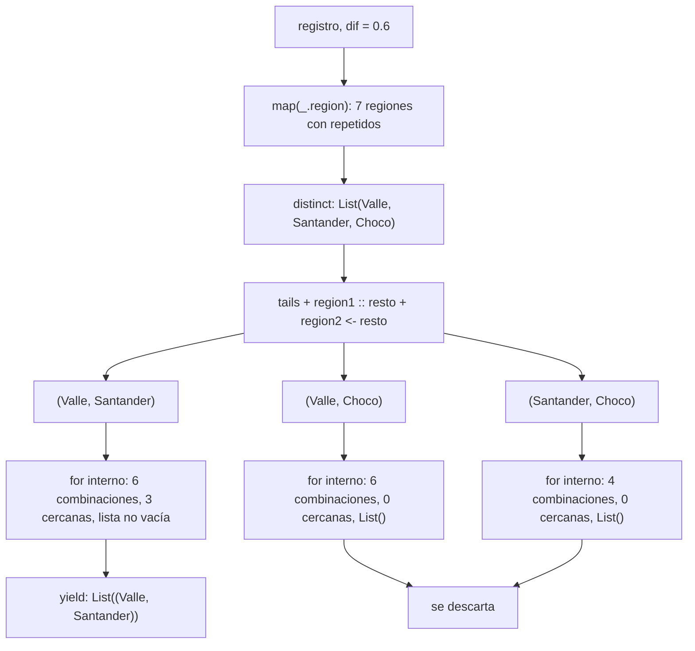

# Informe de proceso — Punto 1: consultas con expresiones `for`

En el punto 1 se resuelven tres consultas sobre el registro sísmico: `fuertes`,
`enRegion` y `paresCercanos`. Las tres se escriben con expresiones `for`, sin
encadenar `filter` y `map` a mano.

## Datos de entrada

Todos los ejemplos usan el registro de `Datos`:

| # | fecha | región | magnitud | profundidad |
|---|---|---|---|---|
| 0 | 2025-03 | Valle | 4.2 | 30 |
| 1 | 2025-03 | Santander | 5.1 | 150 |
| 2 | 2025-04 | Valle | 3.8 | 25 |
| 3 | 2025-04 | Choco | 6.0 | 40 |
| 4 | 2025-05 | Santander | 4.7 | 160 |
| 5 | 2025-05 | Valle | 5.3 | 35 |
| 6 | 2025-06 | Choco | 3.1 | 20 |

Cada fila es un `Sismo`:

```Scala
case class Sismo(fecha: Fecha, region: String, magnitud: Double, profundidad: Int)
```

Con un punto se lee cada campo: si `sismo` es la fila 0, entonces
`sismo.region` es `"Valle"` y `sismo.magnitud` es `4.2`.

## Partes de una expresión `for`

| pieza | ejemplo | qué hace |
|---|---|---|
| **generador** | `sismo <- r` | la variable toma, uno por uno, los elementos de la lista |
| **filtro** | `if (condición)` | deja pasar solo los elementos que cumplen la condición |
| **`yield`** | `yield sismo.region` | lo que se guarda en la lista resultado por cada elemento que pasó el filtro |

El `for` arma una lista nueva: empieza vacía y, en cada vuelta en la que el
filtro da `true`, le agrega al final lo que dice el `yield`. Cuando la vuelta
da `false`, no agrega nada y pasa al siguiente elemento.

Si hay dos generadores seguidos, el segundo se recorre completo por cada valor
del primero, como dos ciclos anidados.

---

## 1. `fuertes`

### Definición

```Scala
def fuertes(r: Registro, umbral: Double): List[String] = {
  for {
    sismo <- r
    if (sismo.magnitud > umbral)
  } yield sismo.region
}
```

* **Entrada:** el registro `r` y un número `umbral`.
* **Salida:** una lista de regiones (`List[String]`).
* **Qué hace:** devuelve la región de cada sismo cuya magnitud supera el
  umbral, en el orden del registro y con repetidos.

La condición es estricta:

magnitud > umbral

### Línea por línea

| línea | significado |
|---|---|
| `sismo <- r` | `sismo` toma cada uno de los 7 sismos, del primero al último |
| `if (sismo.magnitud > umbral)` | se pregunta si la magnitud de ese sismo es mayor que el umbral |
| `yield sismo.region` | si la respuesta es `true`, se guarda solo la región del sismo, no el sismo completo |

### Paso a paso con `fuertes(registro, 5.0)`

Aquí `umbral = 5.0` y la lista resultado empieza vacía: `List()`.

**Vuelta 1.** `sismo = Sismo(Fecha(2025, 3), "Valle", 4.2, 30)`

* `sismo.magnitud` es `4.2`.
* `4.2 > 5.0` da `false`, así que no se guarda nada.
* Resultado parcial: `List()`

**Vuelta 2.** `sismo = Sismo(Fecha(2025, 3), "Santander", 5.1, 150)`

* `sismo.magnitud` es `5.1`.
* `5.1 > 5.0` da `true`, así que se guarda `sismo.region`, que es `"Santander"`.
* Resultado parcial: `List("Santander")`

**Vuelta 3.** `sismo = Sismo(Fecha(2025, 4), "Valle", 3.8, 25)`

* `3.8 > 5.0` da `false`.
* Resultado parcial: `List("Santander")`

**Vuelta 4.** `sismo = Sismo(Fecha(2025, 4), "Choco", 6.0, 40)`

* `6.0 > 5.0` da `true`, así que se guarda `"Choco"`.
* Resultado parcial: `List("Santander", "Choco")`

**Vuelta 5.** `sismo = Sismo(Fecha(2025, 5), "Santander", 4.7, 160)`

* `4.7 > 5.0` da `false`.
* Resultado parcial: `List("Santander", "Choco")`

**Vuelta 6.** `sismo = Sismo(Fecha(2025, 5), "Valle", 5.3, 35)`

* `5.3 > 5.0` da `true`, así que se guarda `"Valle"`.
* Resultado parcial: `List("Santander", "Choco", "Valle")`

**Vuelta 7.** `sismo = Sismo(Fecha(2025, 6), "Choco", 3.1, 20)`

* `3.1 > 5.0` da `false`.
* Resultado parcial: `List("Santander", "Choco", "Valle")`

Se acabaron los sismos, así que el `for` termina.

### Resumen de las vueltas

| vuelta | región | magnitud | ¿$magnitud > 5.0$? | resultado parcial |
|---|---|---|---|---|
| 1 | Valle | 4.2 | no | `List()` |
| 2 | Santander | 5.1 | **sí** | `List("Santander")` |
| 3 | Valle | 3.8 | no | `List("Santander")` |
| 4 | Choco | 6.0 | **sí** | `List("Santander", "Choco")` |
| 5 | Santander | 4.7 | no | `List("Santander", "Choco")` |
| 6 | Valle | 5.3 | **sí** | `List("Santander", "Choco", "Valle")` |
| 7 | Choco | 3.1 | no | `List("Santander", "Choco", "Valle")` |

```Scala
fuertes(registro, 5.0) == List("Santander", "Choco", "Valle")
```

### Otras entradas

| llamada | resultado | por qué |
|---|---|---|
| `fuertes(registro, 9.0)` | `List()` | la magnitud más grande es 6.0, y ninguna supera 9.0 |
| `fuertes(registro, 3.0)` | 7 regiones, con repetidos | la magnitud más pequeña es 3.1, y todas superan 3.0 |
| `fuertes(registro, 6.0)` | no contiene `"Choco"` | el sismo de Choco tiene magnitud 6.0, y `6.0 > 6.0` da `false` |

El último caso muestra por qué se usa `>` y no `>=`: un sismo de magnitud
exactamente igual al umbral no entra.

---

## 2. `enRegion`

### Definición

```Scala
def enRegion(r: Registro, region: String): List[Double] = {
  for {
    sismo <- r
    if (sismo.region == region)
  } yield sismo.magnitud
}
```

* **Entrada:** el registro `r` y el nombre de una región.
* **Salida:** una lista de magnitudes (`List[Double]`).
* **Qué hace:** devuelve las magnitudes de todos los sismos de esa región, en
  el orden del registro.

Tiene la misma forma que `fuertes`, pero cambian el filtro y lo que se guarda:

| | `fuertes` | `enRegion` |
|---|---|---|
| filtro | `sismo.magnitud > umbral` | `sismo.region == region` |
| `yield` | `sismo.region` | `sismo.magnitud` |
| tipo del resultado | `List[String]` | `List[Double]` |

### Línea por línea

| línea | significado |
|---|---|
| `sismo <- r` | `sismo` toma cada uno de los 7 sismos, del primero al último |
| `if (sismo.region == region)` | se pregunta si la región del sismo es igual a la que se busca |
| `yield sismo.magnitud` | si la respuesta es `true`, se guarda solo la magnitud del sismo |

### Paso a paso con `enRegion(registro, "Valle")`

Aquí `region = "Valle"` y la lista resultado empieza vacía: `List()`.

**Vuelta 1.** `sismo = Sismo(Fecha(2025, 3), "Valle", 4.2, 30)`

* `sismo.region` es `"Valle"`.
* `"Valle" == "Valle"` da `true`, así que se guarda `sismo.magnitud`, que es `4.2`.
* Resultado parcial: `List(4.2)`

**Vuelta 2.** `sismo = Sismo(Fecha(2025, 3), "Santander", 5.1, 150)`

* `"Santander" == "Valle"` da `false`.
* Resultado parcial: `List(4.2)`

**Vuelta 3.** `sismo = Sismo(Fecha(2025, 4), "Valle", 3.8, 25)`

* `"Valle" == "Valle"` da `true`, así que se guarda `3.8`.
* Resultado parcial: `List(4.2, 3.8)`

**Vuelta 4.** `sismo = Sismo(Fecha(2025, 4), "Choco", 6.0, 40)`

* `"Choco" == "Valle"` da `false`.
* Resultado parcial: `List(4.2, 3.8)`

**Vuelta 5.** `sismo = Sismo(Fecha(2025, 5), "Santander", 4.7, 160)`

* `"Santander" == "Valle"` da `false`.
* Resultado parcial: `List(4.2, 3.8)`

**Vuelta 6.** `sismo = Sismo(Fecha(2025, 5), "Valle", 5.3, 35)`

* `"Valle" == "Valle"` da `true`, así que se guarda `5.3`.
* Resultado parcial: `List(4.2, 3.8, 5.3)`

**Vuelta 7.** `sismo = Sismo(Fecha(2025, 6), "Choco", 3.1, 20)`

* `"Choco" == "Valle"` da `false`.
* Resultado parcial: `List(4.2, 3.8, 5.3)`

### Resumen de las vueltas

| vuelta | región | ¿es `"Valle"`? | se guarda | resultado parcial |
|---|---|---|---|---|
| 1 | Valle | **sí** | `4.2` | `List(4.2)` |
| 2 | Santander | no | | `List(4.2)` |
| 3 | Valle | **sí** | `3.8` | `List(4.2, 3.8)` |
| 4 | Choco | no | | `List(4.2, 3.8)` |
| 5 | Santander | no | | `List(4.2, 3.8)` |
| 6 | Valle | **sí** | `5.3` | `List(4.2, 3.8, 5.3)` |
| 7 | Choco | no | | `List(4.2, 3.8, 5.3)` |

```Scala
enRegion(registro, "Valle") == List(4.2, 3.8, 5.3)
```

### Otras entradas

| llamada | resultado | por qué |
|---|---|---|
| `enRegion(registro, "Santander")` | `List(5.1, 4.7)` | sismos 1 y 4 |
| `enRegion(registro, "Choco")` | `List(6.0, 3.1)` | sismos 3 y 6 |
| `enRegion(registro, "Amazonas")` | `List()` | ningún sismo es de Amazonas, así que el filtro siempre da `false` |
| `enRegion(List(), "Valle")` | `List()` | el registro está vacío, así que el generador no da ninguna vuelta |

`paresCercanos` reutiliza esta función para obtener las magnitudes de cada
región.

---

## 3. `paresCercanos`

### Definición

```Scala
def paresCercanos(r: Registro, dif: Double): List[(String, String)] = {
  val regiones = r.map(_.region).distinct
  for {
    region1 :: resto <- regiones.tails.toList
    region2 <- resto
    if ((for {
      magnitud1 <- enRegion(r, region1)
      magnitud2 <- enRegion(r, region2)
      if (math.abs(magnitud1 - magnitud2) <= dif)
    } yield (magnitud1, magnitud2)) != List())
  } yield (region1, region2)
}
```

* **Entrada:** el registro `r` y un número `dif`.
* **Salida:** una lista de parejas de regiones (`List[(String, String)]`).
* **Qué hace:** devuelve las parejas de regiones distintas que tienen al
  menos un sismo de cada una con magnitudes cercanas.

`dif` no es la diferencia en sí, sino la diferencia máxima permitida. Dos
magnitudes son cercanas si:

$$|magnitud_1 - magnitud_2| \le dif$$

Se usa el valor absoluto (`math.abs`) porque la resta puede salir negativa
(`4.2 - 4.7 = -0.5`), y solo importa qué tan lejos están las magnitudes, no
cuál es mayor.

La función debe cumplir tres cosas:

* cada pareja sale una sola vez (no aparecen `("Valle", "Santander")` y `("Santander", "Valle")` a la vez);
* una región nunca se empareja consigo misma;
* las parejas salen en el orden de aparición de las regiones.

### Por qué se recorren regiones y no sismos

Una primera versión comparaba sismo contra sismo y guardaba
`(sismo.region, sismo2.region)`. Con `dif = 0.6` eso producía:

* sismo 0 (Valle 4.2) con sismo 4 (Santander 4.7), que da `("Valle", "Santander")`;
* sismo 1 (Santander 5.1) con sismo 5 (Valle 5.3), que da `("Santander", "Valle")`.

`distinct` no junta esas dos parejas, porque son tuplas diferentes, y además el
orden dependía de los sismos y no de las regiones. Por eso la versión final
recorre regiones: primero arma cada pareja de regiones una sola vez, y
después revisa si sus sismos tienen magnitudes cercanas.

### Estructura de la función

La función tiene dos `for`, uno dentro del otro:

| `for` | qué recorre | qué pregunta | qué guarda |
|---|---|---|---|
| de afuera | parejas de **regiones** | ¿esta pareja tiene sismos cercanos? | `(region1, region2)` |
| de adentro | parejas de **magnitudes**, una de cada región | ¿estas dos magnitudes están a `dif` o menos? | `(magnitud1, magnitud2)` |

### Ejemplo: `paresCercanos(registro, 0.6)`

#### Paso 1: sacar la región de cada sismo con `map`

```Scala
r.map(_.region)
```

`map` aplica `_.region` a cada sismo, es decir, cambia cada sismo por su
región. `_.region` es una forma corta de escribir `sismo => sismo.region`.

| sismo | `_.region` |
|---|---|
| `Sismo(..., "Valle", 4.2, 30)` | `"Valle"` |
| `Sismo(..., "Santander", 5.1, 150)` | `"Santander"` |
| `Sismo(..., "Valle", 3.8, 25)` | `"Valle"` |
| `Sismo(..., "Choco", 6.0, 40)` | `"Choco"` |
| `Sismo(..., "Santander", 4.7, 160)` | `"Santander"` |
| `Sismo(..., "Valle", 5.3, 35)` | `"Valle"` |
| `Sismo(..., "Choco", 3.1, 20)` | `"Choco"` |

```Scala
r.map(_.region) == List("Valle", "Santander", "Valle", "Choco", "Santander", "Valle", "Choco")
```

#### Paso 2: quitar los repetidos con `distinct`

`distinct` recorre la lista y deja cada elemento **la primera vez** que
aparece; las siguientes veces lo salta:

| elemento | ¿ya apareció? | lista sin repetidos |
|---|---|---|
| `"Valle"` | no | `List("Valle")` |
| `"Santander"` | no | `List("Valle", "Santander")` |
| `"Valle"` | sí, se salta | `List("Valle", "Santander")` |
| `"Choco"` | no | `List("Valle", "Santander", "Choco")` |
| `"Santander"` | sí, se salta | `List("Valle", "Santander", "Choco")` |
| `"Valle"` | sí, se salta | `List("Valle", "Santander", "Choco")` |
| `"Choco"` | sí, se salta | `List("Valle", "Santander", "Choco")` |

```Scala
val regiones = List("Valle", "Santander", "Choco")
```

Las regiones quedan en el orden en que aparecen por primera vez en el
registro. Ese es el orden que piden las pruebas.

#### Paso 3: las colas de la lista con `tails`

```Scala
regiones.tails.toList
```

`tails` devuelve la lista completa y luego la misma lista quitándole cada vez
el primer elemento, hasta llegar a la lista vacía. `toList` convierte ese
resultado en una lista para poder recorrerlo con el `for`:

```Scala
List(
  List("Valle", "Santander", "Choco"),
  List("Santander", "Choco"),
  List("Choco"),
  List()
)
```

#### Paso 4: separar cabeza y resto con `region1 :: resto`

```Scala
region1 :: resto <- regiones.tails.toList
```

El generador toma cada cola y la parte en dos con el patrón `::`:

* `region1` es el primer elemento de la cola (la cabeza)
* `resto` es todo lo demás

| cola | `region1` | `resto` |
|---|---|---|
| `List("Valle", "Santander", "Choco")` | `"Valle"` | `List("Santander", "Choco")` |
| `List("Santander", "Choco")` | `"Santander"` | `List("Choco")` |
| `List("Choco")` | `"Choco"` | `List()` |
| `List()` | no tiene primer elemento, así que no encaja con el patrón y se salta | |

#### Paso 5: armar las parejas con `region2 <- resto`

```Scala
region2 <- resto
```

Por cada `region1`, `region2` toma cada elemento de su `resto`:

| `region1` | `resto` | `region2` toma | parejas |
|---|---|---|---|
| `"Valle"` | `List("Santander", "Choco")` | `"Santander"`, luego `"Choco"` | `(Valle, Santander)`, `(Valle, Choco)` |
| `"Santander"` | `List("Choco")` | `"Choco"` | `(Santander, Choco)` |
| `"Choco"` | `List()` | nada, el `resto` está vacío | ninguna |

Salen tres parejas candidatas:

```
(Valle, Santander)   (Valle, Choco)   (Santander, Choco)
```

Como `region2` siempre se toma del `resto`, siempre viene después de
`region1`. Por eso:

* nunca sale `(Valle, Valle)`, porque Valle no está en su propio `resto`;
* nunca sale `(Santander, Valle)`, porque Valle no está en el `resto` de Santander;
* las parejas salen en el orden de las regiones.


#### Paso 6: el `for` de adentro revisa cada pareja

Cada pareja pasa por el filtro del `for` de afuera, y ese filtro es
otro `for`:

```Scala
for {
  magnitud1 <- enRegion(r, region1)
  magnitud2 <- enRegion(r, region2)
  if (math.abs(magnitud1 - magnitud2) <= dif)
} yield (magnitud1, magnitud2)
```

| línea | qué hace |
|---|---|
| `magnitud1 <- enRegion(r, region1)` | **generador**: `magnitud1` toma, una por una, las magnitudes de `region1` |
| `magnitud2 <- enRegion(r, region2)` | **generador**: por cada `magnitud1`, `magnitud2` toma, una por una, las magnitudes de `region2` |
| `if (math.abs(magnitud1 - magnitud2) <= dif)` | **filtro**: deja pasar solo las combinaciones cercanas |
| `yield (magnitud1, magnitud2)` | guarda la pareja de magnitudes que pasó el filtro |

Los dos generadores funcionan como un reloj: el segundo da toda la vuelta antes
de que el primero avance. Así, cada sismo de `region1` se compara con cada sismo
de `region2`. Si `region1` tiene n sismos y `region2` tiene m, salen
n * m combinaciones.

##### Pareja 1: (Valle, Santander)

Primero se reemplaza cada `enRegion` por lo que devuelve:

```Scala
magnitud1 <- List(4.2, 3.8, 5.3)   // Valle
magnitud2 <- List(5.1, 4.7)        // Santander
```

Son $3 * 2 = 6$ combinaciones. La lista del `for` de adentro empieza vacía.

**`magnitud1 = 4.2`**: `magnitud2` recorre toda la lista de Santander.

* `magnitud2 = 5.1`: `4.2 - 5.1 = -0.9`, y `math.abs(-0.9) = 0.9`. `0.9 <= 0.6` da `false`. Resultado parcial: `List()`
* `magnitud2 = 4.7`: `4.2 - 4.7 = -0.5`, y `math.abs(-0.5) = 0.5`. `0.5 <= 0.6` da `true`, así que se guarda `(4.2, 4.7)`. Resultado parcial: `List((4.2, 4.7))`

**`magnitud1 = 3.8`**: `magnitud2` vuelve a empezar desde el principio.

* `magnitud2 = 5.1`: `math.abs(3.8 - 5.1) = 1.3`. `1.3 <= 0.6` da `false`. Resultado parcial: `List((4.2, 4.7))`
* `magnitud2 = 4.7`: `math.abs(3.8 - 4.7) = 0.9`. `0.9 <= 0.6` da `false`. Resultado parcial: `List((4.2, 4.7))`

**`magnitud1 = 5.3`**: `magnitud2` vuelve a empezar desde el principio.

* `magnitud2 = 5.1`: `math.abs(5.3 - 5.1) = 0.2`. `0.2 <= 0.6` da `true`, así que se guarda `(5.3, 5.1)`. Resultado parcial: `List((4.2, 4.7), (5.3, 5.1))`
* `magnitud2 = 4.7`: `math.abs(5.3 - 4.7) = 0.6`. `0.6 <= 0.6` da `true`, así que se guarda `(5.3, 4.7)`. Resultado parcial: `List((4.2, 4.7), (5.3, 5.1), (5.3, 4.7))`

| magnitud1 | magnitud2 | resta | `math.abs` | ¿$\le 0.6$? |
|---|---|---|---|---|
| 4.2 | 5.1 | -0.9 | 0.9 | no |
| 4.2 | 4.7 | -0.5 | 0.5 | **sí** |
| 3.8 | 5.1 | -1.3 | 1.3 | no |
| 3.8 | 4.7 | -0.9 | 0.9 | no |
| 5.3 | 5.1 | 0.2 | 0.2 | **sí** |
| 5.3 | 4.7 | 0.6 | 0.6 | **sí** |

Resultado del `for` de adentro:

```Scala
List((4.2, 4.7), (5.3, 5.1), (5.3, 4.7))
```

##### Pareja 2: (Valle, Choco)

```Scala
magnitud1 <- List(4.2, 3.8, 5.3)   // Valle
magnitud2 <- List(6.0, 3.1)        // Choco
```

Son $3 * 2 = 6$ combinaciones:

| magnitud1 | magnitud2 | resta | `math.abs` | ¿$ <= 0.6$? | resultado parcial |
|---|---|---|---|---|---|
| 4.2 | 6.0 | -1.8 | 1.8 | no | `List()` |
| 4.2 | 3.1 | 1.1 | 1.1 | no | `List()` |
| 3.8 | 6.0 | -2.2 | 2.2 | no | `List()` |
| 3.8 | 3.1 | 0.7 | 0.7 | no | `List()` |
| 5.3 | 6.0 | -0.7 | 0.7 | no | `List()` |
| 5.3 | 3.1 | 2.2 | 2.2 | no | `List()` |

Las más cercanas son 3.8 con 3.1 y 5.3 con 6.0, pero las dos están a 0.7, que
es más que 0.6. Ninguna combinación pasa el filtro, así que el resultado del
`for` de adentro es `List()`.

##### Pareja 3: (Santander, Choco)

```Scala
magnitud1 <- List(5.1, 4.7)   // Santander
magnitud2 <- List(6.0, 3.1)   // Choco
```

Son $2 * 2 = 4$ combinaciones:

| magnitud1 | magnitud2 | resta | `math.abs` | ¿$\le 0.6$? | resultado parcial |
|---|---|---|---|---|---|
| 5.1 | 6.0 | -0.9 | 0.9 | no | `List()` |
| 5.1 | 3.1 | 2.0 | 2.0 | no | `List()` |
| 4.7 | 6.0 | -1.3 | 1.3 | no | `List()` |
| 4.7 | 3.1 | 1.6 | 1.6 | no | `List()` |

El resultado del `for` de adentro es `List()`.

#### Paso 7: comparar con `List()`

Todo el `for` de adentro está dentro del `if` del `for` de afuera:

```Scala
if ((for { ... } yield (magnitud1, magnitud2)) != List())
```

`!=` significa "es diferente de". La condición pregunta si la lista que armó
el `for` de adentro es diferente de la lista vacía:

* Si la lista tiene algo, hubo al menos un sismo de `region1` cerca de uno de `region2`. La condición da `true` y la pareja de regiones **entra**.
* Si la lista está vacía, ningún sismo estuvo cerca. La condición da `false` y la pareja se descarta.

Al `for` de afuera no le importa cuáles son las parejas de magnitudes, ni
cuántas hay; solo le importa si hay alguna.

| pareja | resultado del `for` de adentro | `!= List()` | ¿entra? |
|---|---|---|---|
| (Valle, Santander) | `List((4.2, 4.7), (5.3, 5.1), (5.3, 4.7))` | `true` | sí |
| (Valle, Choco) | `List()` | `false` | no |
| (Santander, Choco) | `List()` | `false` | no |

#### Paso 8: el `yield` de afuera

```Scala
} yield (region1, region2)
```

El `for` de afuera también arma su lista desde vacía, y en cada vuelta en la
que el `if` da `true` agrega la pareja de regiones:

| vuelta | `region1` | `region2` | ¿pasa el `if`? | resultado parcial |
|---|---|---|---|---|
| 1 | Valle | Santander | sí | `List(("Valle", "Santander"))` |
| 2 | Valle | Choco | no | `List(("Valle", "Santander"))` |
| 3 | Santander | Choco | no | `List(("Valle", "Santander"))` |

```Scala
paresCercanos(registro, 0.6) == List(("Valle", "Santander"))
```

### Otra entrada: `paresCercanos(registro, 1.0)`

Las parejas candidatas son las mismas tres (los pasos 1 a 5 no dependen de
`dif`), pero ahora el filtro acepta diferencias hasta 1.0:

| pareja | combinaciones con $ magnitud_1 - magnitud_2 <= 1.0$ | ¿entra? |
|---|---|---|
| (Valle, Santander) | `(4.2, 5.1)`, `(4.2, 4.7)`, `(3.8, 4.7)`, `(5.3, 5.1)`, `(5.3, 4.7)` | sí|
| (Valle, Choco) | `(3.8, 3.1)` a 0.7, `(5.3, 6.0)` a 0.7 | sí |
| (Santander, Choco) | `(5.1, 6.0)` a 0.9 | sí |

```Scala
paresCercanos(registro, 1.0) ==
  List(("Valle", "Santander"), ("Valle", "Choco"), ("Santander", "Choco"))
```

### Otra entrada: `paresCercanos(registro, 0.1)`

La diferencia más pequeña entre sismos de regiones distintas es 0.2 (5.3 de
Valle y 5.1 de Santander). Como 0.2 es más que 0.1, el `for` de adentro da
`List()` para las tres parejas:

```Scala
paresCercanos(registro, 0.1) == List()
```

### Diagrama del proceso



---

## Pruebas del punto 1

Todas las pruebas del punto 1 en `RegistroSismicoTest.scala` pasan con
`./gradlew test`:

| función | prueba |
|---|---|
| `fuertes` | los que superan 5.0, en orden |
| `fuertes` | con un umbral alto no queda ninguno |
| `fuertes` | conserva los repetidos |
| `fuertes` | el umbral es estricto |
| `enRegion` | las magnitudes del Valle |
| `enRegion` | una región que no está da la lista vacía |
| `enRegion` | sobre el registro vacío no hay magnitudes |
| `paresCercanos` | con 0.6 solo Valle y Santander |
| `paresCercanos` | con 1.0 salen las tres parejas, en orden de aparición |
| `paresCercanos` | con 0.1 no hay ninguna |
| `paresCercanos` | cada pareja sale una sola vez |
| `paresCercanos` | nunca empareja una región consigo misma |
