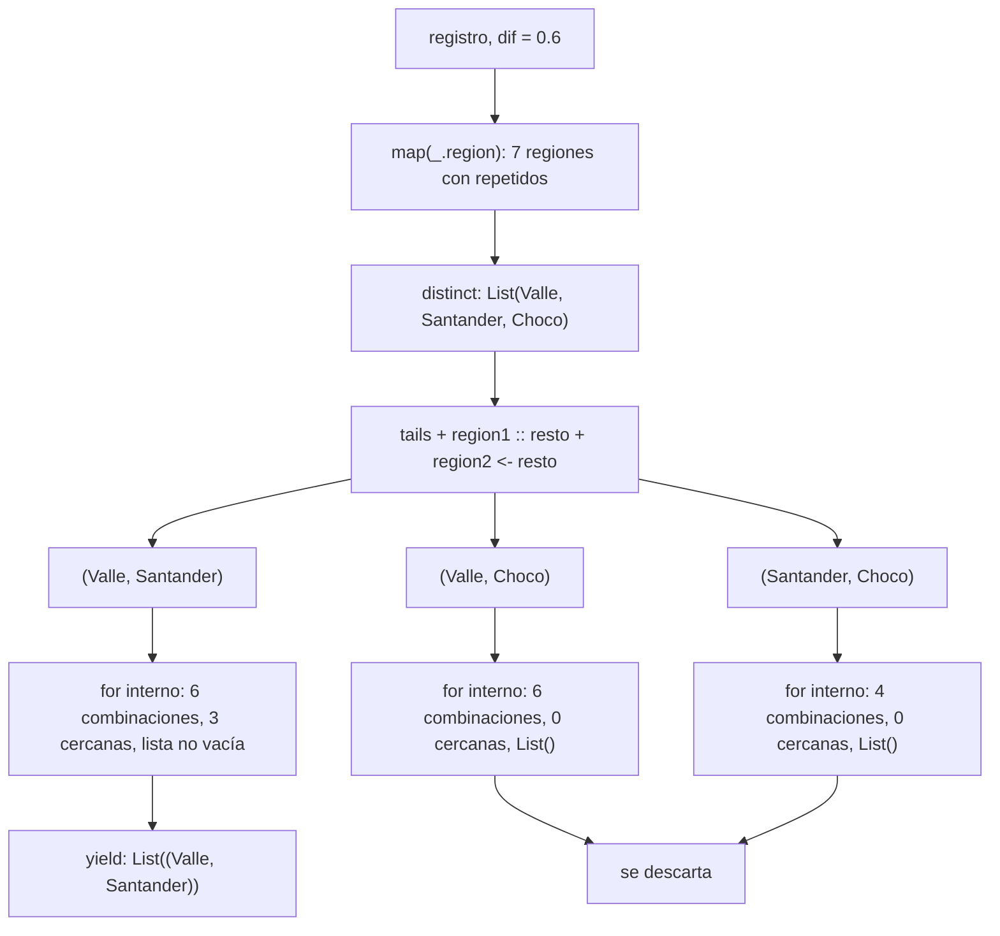
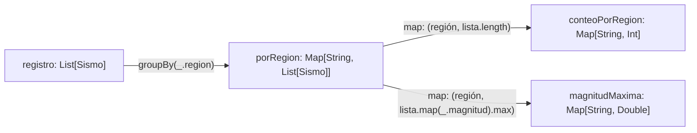
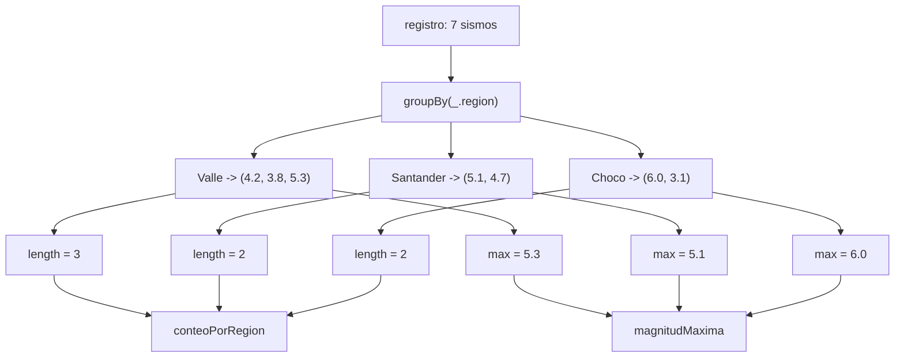
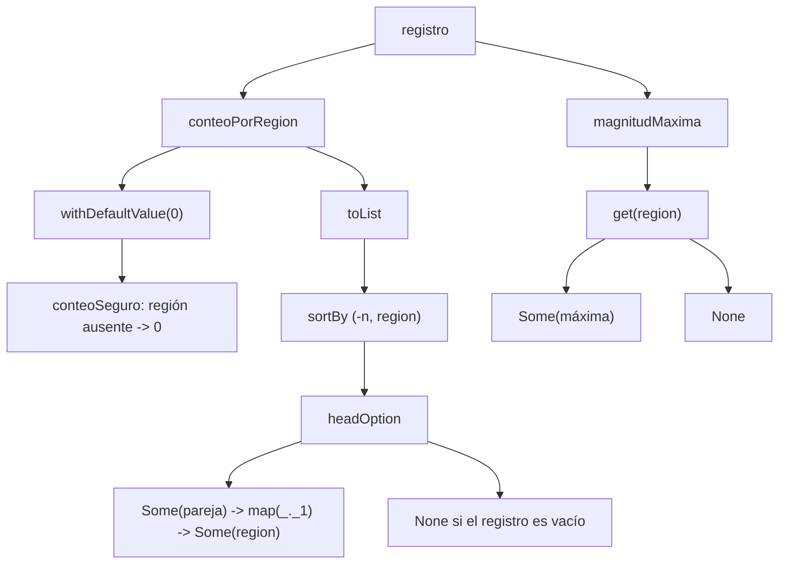
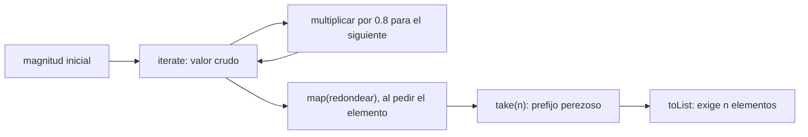
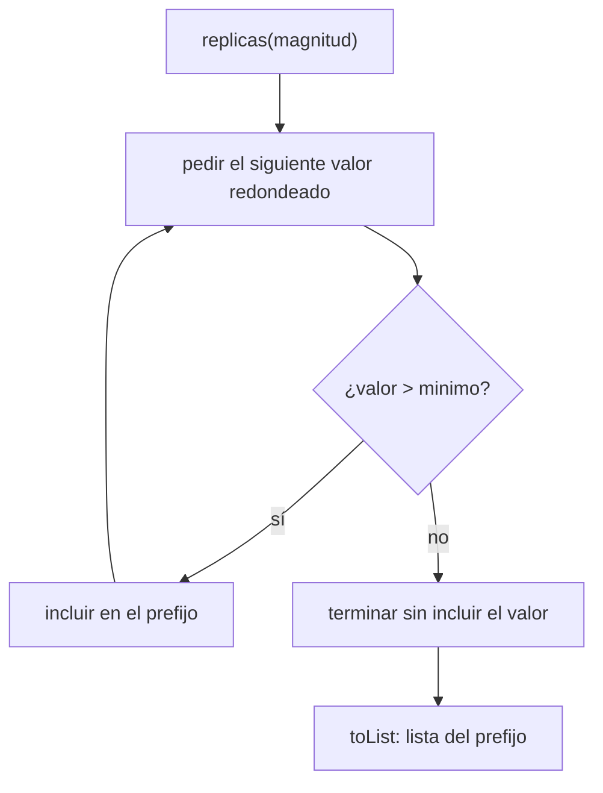
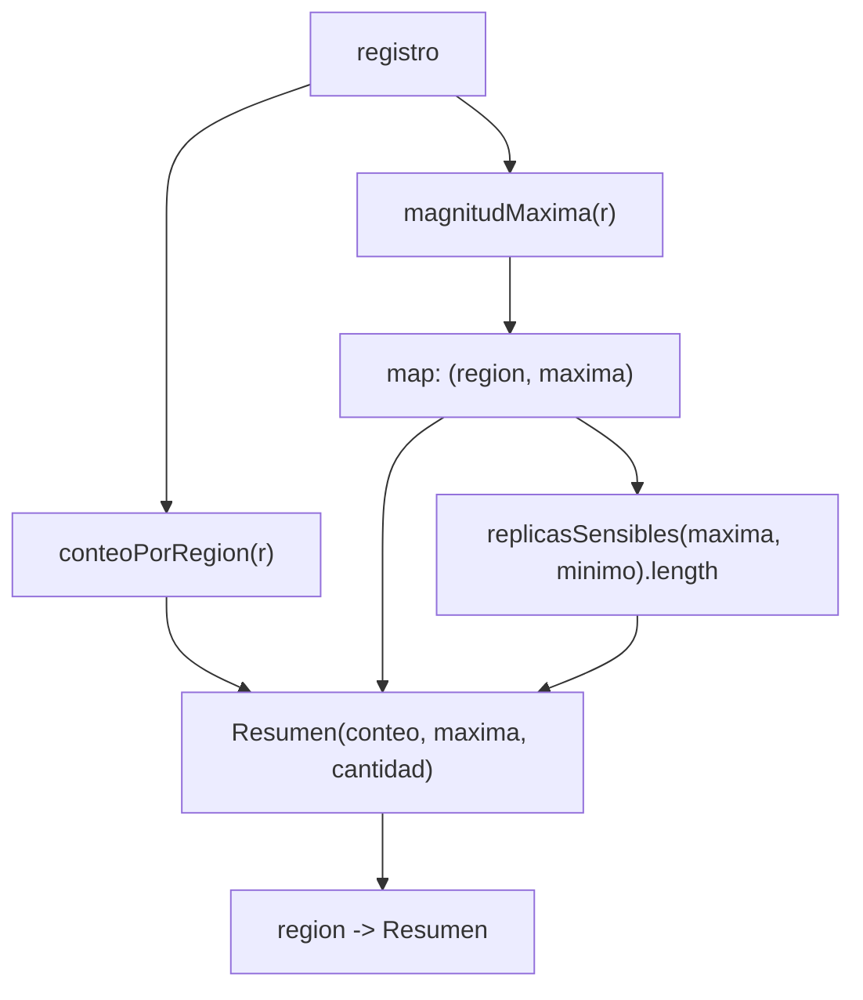

# Informe de proceso — Punto 1: consultas con expresiones `for`

En el punto 1 se resuelven tres consultas sobre el registro sísmico: `fuertes`,
`enRegion` y `paresCercanos`. Las tres se escriben con expresiones `for`, sin
encadenar `filter` y `map` a mano.

## Datos de entrada

Todos los ejemplos usan el registro de `Datos`:

| # | fecha | región | magnitud | profundidad |
|---|---|---|---|---|
| 0 | 2025-03 | Valle | 4.2 | 30 |
| 1 | 2025-03 | Santander | 5.1 | 150 |
| 2 | 2025-04 | Valle | 3.8 | 25 |
| 3 | 2025-04 | Choco | 6.0 | 40 |
| 4 | 2025-05 | Santander | 4.7 | 160 |
| 5 | 2025-05 | Valle | 5.3 | 35 |
| 6 | 2025-06 | Choco | 3.1 | 20 |

Cada fila es un `Sismo`:

```Scala
case class Sismo(fecha: Fecha, region: String, magnitud: Double, profundidad: Int)
```

Con un punto se lee cada campo: si `sismo` es la fila 0, entonces
`sismo.region` es `"Valle"` y `sismo.magnitud` es `4.2`.

## Partes de una expresión `for`

| pieza | ejemplo | qué hace |
|---|---|---|
| **generador** | `sismo <- r` | la variable toma, uno por uno, los elementos de la lista |
| **filtro** | `if (condición)` | deja pasar solo los elementos que cumplen la condición |
| **`yield`** | `yield sismo.region` | lo que se guarda en la lista resultado por cada elemento que pasó el filtro |

El `for` arma una lista nueva: empieza vacía y, en cada vuelta en la que el
filtro da `true`, le agrega al final lo que dice el `yield`. Cuando la vuelta
da `false`, no agrega nada y pasa al siguiente elemento.

Si hay dos generadores seguidos, el segundo se recorre completo por cada valor
del primero, como dos ciclos anidados.

---

## 1. `fuertes`

### Definición

```Scala
def fuertes(r: Registro, umbral: Double): List[String] = {
  for {
    sismo <- r
    if (sismo.magnitud > umbral)
  } yield sismo.region
}
```

* **Entrada:** el registro `r` y un número `umbral`.
* **Salida:** una lista de regiones (`List[String]`).
* **Qué hace:** devuelve la región de cada sismo cuya magnitud supera el
  umbral, en el orden del registro y con repetidos.

La condición es estricta:

magnitud > umbral

### Línea por línea

| línea | significado |
|---|---|
| `sismo <- r` | `sismo` toma cada uno de los 7 sismos, del primero al último |
| `if (sismo.magnitud > umbral)` | se pregunta si la magnitud de ese sismo es mayor que el umbral |
| `yield sismo.region` | si la respuesta es `true`, se guarda solo la región del sismo, no el sismo completo |

### Paso a paso con `fuertes(registro, 5.0)`

Aquí `umbral = 5.0` y la lista resultado empieza vacía: `List()`.

**Vuelta 1.** `sismo = Sismo(Fecha(2025, 3), "Valle", 4.2, 30)`

* `sismo.magnitud` es `4.2`.
* `4.2 > 5.0` da `false`, así que no se guarda nada.
* Resultado parcial: `List()`

**Vuelta 2.** `sismo = Sismo(Fecha(2025, 3), "Santander", 5.1, 150)`

* `sismo.magnitud` es `5.1`.
* `5.1 > 5.0` da `true`, así que se guarda `sismo.region`, que es `"Santander"`.
* Resultado parcial: `List("Santander")`

**Vuelta 3.** `sismo = Sismo(Fecha(2025, 4), "Valle", 3.8, 25)`

* `3.8 > 5.0` da `false`.
* Resultado parcial: `List("Santander")`

**Vuelta 4.** `sismo = Sismo(Fecha(2025, 4), "Choco", 6.0, 40)`

* `6.0 > 5.0` da `true`, así que se guarda `"Choco"`.
* Resultado parcial: `List("Santander", "Choco")`

**Vuelta 5.** `sismo = Sismo(Fecha(2025, 5), "Santander", 4.7, 160)`

* `4.7 > 5.0` da `false`.
* Resultado parcial: `List("Santander", "Choco")`

**Vuelta 6.** `sismo = Sismo(Fecha(2025, 5), "Valle", 5.3, 35)`

* `5.3 > 5.0` da `true`, así que se guarda `"Valle"`.
* Resultado parcial: `List("Santander", "Choco", "Valle")`

**Vuelta 7.** `sismo = Sismo(Fecha(2025, 6), "Choco", 3.1, 20)`

* `3.1 > 5.0` da `false`.
* Resultado parcial: `List("Santander", "Choco", "Valle")`

Se acabaron los sismos, así que el `for` termina.

### Resumen de las vueltas

| vuelta | región | magnitud | ¿$magnitud > 5.0$? | resultado parcial |
|---|---|---|---|---|
| 1 | Valle | 4.2 | no | `List()` |
| 2 | Santander | 5.1 | **sí** | `List("Santander")` |
| 3 | Valle | 3.8 | no | `List("Santander")` |
| 4 | Choco | 6.0 | **sí** | `List("Santander", "Choco")` |
| 5 | Santander | 4.7 | no | `List("Santander", "Choco")` |
| 6 | Valle | 5.3 | **sí** | `List("Santander", "Choco", "Valle")` |
| 7 | Choco | 3.1 | no | `List("Santander", "Choco", "Valle")` |

```Scala
fuertes(registro, 5.0) == List("Santander", "Choco", "Valle")
```

### Otras entradas

| llamada | resultado | por qué |
|---|---|---|
| `fuertes(registro, 9.0)` | `List()` | la magnitud más grande es 6.0, y ninguna supera 9.0 |
| `fuertes(registro, 3.0)` | 7 regiones, con repetidos | la magnitud más pequeña es 3.1, y todas superan 3.0 |
| `fuertes(registro, 6.0)` | no contiene `"Choco"` | el sismo de Choco tiene magnitud 6.0, y `6.0 > 6.0` da `false` |

El último caso muestra por qué se usa `>` y no `>=`: un sismo de magnitud
exactamente igual al umbral no entra.

---

## 2. `enRegion`

### Definición

```Scala
def enRegion(r: Registro, region: String): List[Double] = {
  for {
    sismo <- r
    if (sismo.region == region)
  } yield sismo.magnitud
}
```

* **Entrada:** el registro `r` y el nombre de una región.
* **Salida:** una lista de magnitudes (`List[Double]`).
* **Qué hace:** devuelve las magnitudes de todos los sismos de esa región, en
  el orden del registro.

Tiene la misma forma que `fuertes`, pero cambian el filtro y lo que se guarda:

| | `fuertes` | `enRegion` |
|---|---|---|
| filtro | `sismo.magnitud > umbral` | `sismo.region == region` |
| `yield` | `sismo.region` | `sismo.magnitud` |
| tipo del resultado | `List[String]` | `List[Double]` |

### Línea por línea

| línea | significado |
|---|---|
| `sismo <- r` | `sismo` toma cada uno de los 7 sismos, del primero al último |
| `if (sismo.region == region)` | se pregunta si la región del sismo es igual a la que se busca |
| `yield sismo.magnitud` | si la respuesta es `true`, se guarda solo la magnitud del sismo |

### Paso a paso con `enRegion(registro, "Valle")`

Aquí `region = "Valle"` y la lista resultado empieza vacía: `List()`.

**Vuelta 1.** `sismo = Sismo(Fecha(2025, 3), "Valle", 4.2, 30)`

* `sismo.region` es `"Valle"`.
* `"Valle" == "Valle"` da `true`, así que se guarda `sismo.magnitud`, que es `4.2`.
* Resultado parcial: `List(4.2)`

**Vuelta 2.** `sismo = Sismo(Fecha(2025, 3), "Santander", 5.1, 150)`

* `"Santander" == "Valle"` da `false`.
* Resultado parcial: `List(4.2)`

**Vuelta 3.** `sismo = Sismo(Fecha(2025, 4), "Valle", 3.8, 25)`

* `"Valle" == "Valle"` da `true`, así que se guarda `3.8`.
* Resultado parcial: `List(4.2, 3.8)`

**Vuelta 4.** `sismo = Sismo(Fecha(2025, 4), "Choco", 6.0, 40)`

* `"Choco" == "Valle"` da `false`.
* Resultado parcial: `List(4.2, 3.8)`

**Vuelta 5.** `sismo = Sismo(Fecha(2025, 5), "Santander", 4.7, 160)`

* `"Santander" == "Valle"` da `false`.
* Resultado parcial: `List(4.2, 3.8)`

**Vuelta 6.** `sismo = Sismo(Fecha(2025, 5), "Valle", 5.3, 35)`

* `"Valle" == "Valle"` da `true`, así que se guarda `5.3`.
* Resultado parcial: `List(4.2, 3.8, 5.3)`

**Vuelta 7.** `sismo = Sismo(Fecha(2025, 6), "Choco", 3.1, 20)`

* `"Choco" == "Valle"` da `false`.
* Resultado parcial: `List(4.2, 3.8, 5.3)`

### Resumen de las vueltas

| vuelta | región | ¿es `"Valle"`? | se guarda | resultado parcial |
|---|---|---|---|---|
| 1 | Valle | **sí** | `4.2` | `List(4.2)` |
| 2 | Santander | no | | `List(4.2)` |
| 3 | Valle | **sí** | `3.8` | `List(4.2, 3.8)` |
| 4 | Choco | no | | `List(4.2, 3.8)` |
| 5 | Santander | no | | `List(4.2, 3.8)` |
| 6 | Valle | **sí** | `5.3` | `List(4.2, 3.8, 5.3)` |
| 7 | Choco | no | | `List(4.2, 3.8, 5.3)` |

```Scala
enRegion(registro, "Valle") == List(4.2, 3.8, 5.3)
```

### Otras entradas

| llamada | resultado | por qué |
|---|---|---|
| `enRegion(registro, "Santander")` | `List(5.1, 4.7)` | sismos 1 y 4 |
| `enRegion(registro, "Choco")` | `List(6.0, 3.1)` | sismos 3 y 6 |
| `enRegion(registro, "Amazonas")` | `List()` | ningún sismo es de Amazonas, así que el filtro siempre da `false` |
| `enRegion(List(), "Valle")` | `List()` | el registro está vacío, así que el generador no da ninguna vuelta |

`paresCercanos` reutiliza esta función para obtener las magnitudes de cada
región.

---

## 3. `paresCercanos`

### Definición

```Scala
def paresCercanos(r: Registro, dif: Double): List[(String, String)] = {
  val regiones = r.map(_.region).distinct
  for {
    region1 :: resto <- regiones.tails.toList
    region2 <- resto
    if ((for {
      magnitud1 <- enRegion(r, region1)
      magnitud2 <- enRegion(r, region2)
      if (math.abs(magnitud1 - magnitud2) <= dif)
    } yield (magnitud1, magnitud2)) != List())
  } yield (region1, region2)
}
```

* **Entrada:** el registro `r` y un número `dif`.
* **Salida:** una lista de parejas de regiones (`List[(String, String)]`).
* **Qué hace:** devuelve las parejas de regiones distintas que tienen al
  menos un sismo de cada una con magnitudes cercanas.

`dif` no es la diferencia en sí, sino la diferencia máxima permitida. Dos
magnitudes son cercanas si:

$$|magnitud_1 - magnitud_2| \le dif$$

Se usa el valor absoluto (`math.abs`) porque la resta puede salir negativa
(`4.2 - 4.7 = -0.5`), y solo importa qué tan lejos están las magnitudes, no
cuál es mayor.

La función debe cumplir tres cosas:

* cada pareja sale una sola vez (no aparecen `("Valle", "Santander")` y `("Santander", "Valle")` a la vez);
* una región nunca se empareja consigo misma;
* las parejas salen en el orden de aparición de las regiones.

### Por qué se recorren regiones y no sismos

Una primera versión comparaba sismo contra sismo y guardaba
`(sismo.region, sismo2.region)`. Con `dif = 0.6` eso producía:

* sismo 0 (Valle 4.2) con sismo 4 (Santander 4.7), que da `("Valle", "Santander")`;
* sismo 1 (Santander 5.1) con sismo 5 (Valle 5.3), que da `("Santander", "Valle")`.

`distinct` no junta esas dos parejas, porque son tuplas diferentes, y además el
orden dependía de los sismos y no de las regiones. Por eso la versión final
recorre regiones: primero arma cada pareja de regiones una sola vez, y
después revisa si sus sismos tienen magnitudes cercanas.

### Estructura de la función

La función tiene dos `for`, uno dentro del otro:

| `for` | qué recorre | qué pregunta | qué guarda |
|---|---|---|---|
| de afuera | parejas de **regiones** | ¿esta pareja tiene sismos cercanos? | `(region1, region2)` |
| de adentro | parejas de **magnitudes**, una de cada región | ¿estas dos magnitudes están a `dif` o menos? | `(magnitud1, magnitud2)` |

### Ejemplo: `paresCercanos(registro, 0.6)`

#### Paso 1: sacar la región de cada sismo con `map`

```Scala
r.map(_.region)
```

`map` aplica `_.region` a cada sismo, es decir, cambia cada sismo por su
región. `_.region` es una forma corta de escribir `sismo => sismo.region`.

| sismo | `_.region` |
|---|---|
| `Sismo(..., "Valle", 4.2, 30)` | `"Valle"` |
| `Sismo(..., "Santander", 5.1, 150)` | `"Santander"` |
| `Sismo(..., "Valle", 3.8, 25)` | `"Valle"` |
| `Sismo(..., "Choco", 6.0, 40)` | `"Choco"` |
| `Sismo(..., "Santander", 4.7, 160)` | `"Santander"` |
| `Sismo(..., "Valle", 5.3, 35)` | `"Valle"` |
| `Sismo(..., "Choco", 3.1, 20)` | `"Choco"` |

```Scala
r.map(_.region) == List("Valle", "Santander", "Valle", "Choco", "Santander", "Valle", "Choco")
```

#### Paso 2: quitar los repetidos con `distinct`

`distinct` recorre la lista y deja cada elemento **la primera vez** que
aparece; las siguientes veces lo salta:

| elemento | ¿ya apareció? | lista sin repetidos |
|---|---|---|
| `"Valle"` | no | `List("Valle")` |
| `"Santander"` | no | `List("Valle", "Santander")` |
| `"Valle"` | sí, se salta | `List("Valle", "Santander")` |
| `"Choco"` | no | `List("Valle", "Santander", "Choco")` |
| `"Santander"` | sí, se salta | `List("Valle", "Santander", "Choco")` |
| `"Valle"` | sí, se salta | `List("Valle", "Santander", "Choco")` |
| `"Choco"` | sí, se salta | `List("Valle", "Santander", "Choco")` |

```Scala
val regiones = List("Valle", "Santander", "Choco")
```

Las regiones quedan en el orden en que aparecen por primera vez en el
registro. Ese es el orden que piden las pruebas.

#### Paso 3: las colas de la lista con `tails`

```Scala
regiones.tails.toList
```

`tails` devuelve la lista completa y luego la misma lista quitándole cada vez
el primer elemento, hasta llegar a la lista vacía. `toList` convierte ese
resultado en una lista para poder recorrerlo con el `for`:

```Scala
List(
  List("Valle", "Santander", "Choco"),
  List("Santander", "Choco"),
  List("Choco"),
  List()
)
```

#### Paso 4: separar cabeza y resto con `region1 :: resto`

```Scala
region1 :: resto <- regiones.tails.toList
```

El generador toma cada cola y la parte en dos con el patrón `::`:

* `region1` es el primer elemento de la cola (la cabeza)
* `resto` es todo lo demás

| cola | `region1` | `resto` |
|---|---|---|
| `List("Valle", "Santander", "Choco")` | `"Valle"` | `List("Santander", "Choco")` |
| `List("Santander", "Choco")` | `"Santander"` | `List("Choco")` |
| `List("Choco")` | `"Choco"` | `List()` |
| `List()` | no tiene primer elemento, así que no encaja con el patrón y se salta | |

#### Paso 5: armar las parejas con `region2 <- resto`

```Scala
region2 <- resto
```

Por cada `region1`, `region2` toma cada elemento de su `resto`:

| `region1` | `resto` | `region2` toma | parejas |
|---|---|---|---|
| `"Valle"` | `List("Santander", "Choco")` | `"Santander"`, luego `"Choco"` | `(Valle, Santander)`, `(Valle, Choco)` |
| `"Santander"` | `List("Choco")` | `"Choco"` | `(Santander, Choco)` |
| `"Choco"` | `List()` | nada, el `resto` está vacío | ninguna |

Salen tres parejas candidatas:

```
(Valle, Santander)   (Valle, Choco)   (Santander, Choco)
```

Como `region2` siempre se toma del `resto`, siempre viene después de
`region1`. Por eso:

* nunca sale `(Valle, Valle)`, porque Valle no está en su propio `resto`;
* nunca sale `(Santander, Valle)`, porque Valle no está en el `resto` de Santander;
* las parejas salen en el orden de las regiones.


#### Paso 6: el `for` de adentro revisa cada pareja

Cada pareja pasa por el filtro del `for` de afuera, y ese filtro es
otro `for`:

```Scala
for {
  magnitud1 <- enRegion(r, region1)
  magnitud2 <- enRegion(r, region2)
  if (math.abs(magnitud1 - magnitud2) <= dif)
} yield (magnitud1, magnitud2)
```

| línea | qué hace |
|---|---|
| `magnitud1 <- enRegion(r, region1)` | **generador**: `magnitud1` toma, una por una, las magnitudes de `region1` |
| `magnitud2 <- enRegion(r, region2)` | **generador**: por cada `magnitud1`, `magnitud2` toma, una por una, las magnitudes de `region2` |
| `if (math.abs(magnitud1 - magnitud2) <= dif)` | **filtro**: deja pasar solo las combinaciones cercanas |
| `yield (magnitud1, magnitud2)` | guarda la pareja de magnitudes que pasó el filtro |

Los dos generadores funcionan como un reloj: el segundo da toda la vuelta antes
de que el primero avance. Así, cada sismo de `region1` se compara con cada sismo
de `region2`. Si `region1` tiene n sismos y `region2` tiene m, salen
n * m combinaciones.

##### Pareja 1: (Valle, Santander)

Primero se reemplaza cada `enRegion` por lo que devuelve:

```Scala
magnitud1 <- List(4.2, 3.8, 5.3)   // Valle
magnitud2 <- List(5.1, 4.7)        // Santander
```

Son $3 * 2 = 6$ combinaciones. La lista del `for` de adentro empieza vacía.

**`magnitud1 = 4.2`**: `magnitud2` recorre toda la lista de Santander.

* `magnitud2 = 5.1`: `4.2 - 5.1 = -0.9`, y `math.abs(-0.9) = 0.9`. `0.9 <= 0.6` da `false`. Resultado parcial: `List()`
* `magnitud2 = 4.7`: `4.2 - 4.7 = -0.5`, y `math.abs(-0.5) = 0.5`. `0.5 <= 0.6` da `true`, así que se guarda `(4.2, 4.7)`. Resultado parcial: `List((4.2, 4.7))`

**`magnitud1 = 3.8`**: `magnitud2` vuelve a empezar desde el principio.

* `magnitud2 = 5.1`: `math.abs(3.8 - 5.1) = 1.3`. `1.3 <= 0.6` da `false`. Resultado parcial: `List((4.2, 4.7))`
* `magnitud2 = 4.7`: `math.abs(3.8 - 4.7) = 0.9`. `0.9 <= 0.6` da `false`. Resultado parcial: `List((4.2, 4.7))`

**`magnitud1 = 5.3`**: `magnitud2` vuelve a empezar desde el principio.

* `magnitud2 = 5.1`: `math.abs(5.3 - 5.1) = 0.2`. `0.2 <= 0.6` da `true`, así que se guarda `(5.3, 5.1)`. Resultado parcial: `List((4.2, 4.7), (5.3, 5.1))`
* `magnitud2 = 4.7`: `math.abs(5.3 - 4.7) = 0.6`. `0.6 <= 0.6` da `true`, así que se guarda `(5.3, 4.7)`. Resultado parcial: `List((4.2, 4.7), (5.3, 5.1), (5.3, 4.7))`

| magnitud1 | magnitud2 | resta | `math.abs` | ¿$\le 0.6$? |
|---|---|---|---|---|
| 4.2 | 5.1 | -0.9 | 0.9 | no |
| 4.2 | 4.7 | -0.5 | 0.5 | **sí** |
| 3.8 | 5.1 | -1.3 | 1.3 | no |
| 3.8 | 4.7 | -0.9 | 0.9 | no |
| 5.3 | 5.1 | 0.2 | 0.2 | **sí** |
| 5.3 | 4.7 | 0.6 | 0.6 | **sí** |

Resultado del `for` de adentro:

```Scala
List((4.2, 4.7), (5.3, 5.1), (5.3, 4.7))
```

##### Pareja 2: (Valle, Choco)

```Scala
magnitud1 <- List(4.2, 3.8, 5.3)   // Valle
magnitud2 <- List(6.0, 3.1)        // Choco
```

Son $3 * 2 = 6$ combinaciones:

| magnitud1 | magnitud2 | resta | `math.abs` | ¿$ <= 0.6$? | resultado parcial |
|---|---|---|---|---|---|
| 4.2 | 6.0 | -1.8 | 1.8 | no | `List()` |
| 4.2 | 3.1 | 1.1 | 1.1 | no | `List()` |
| 3.8 | 6.0 | -2.2 | 2.2 | no | `List()` |
| 3.8 | 3.1 | 0.7 | 0.7 | no | `List()` |
| 5.3 | 6.0 | -0.7 | 0.7 | no | `List()` |
| 5.3 | 3.1 | 2.2 | 2.2 | no | `List()` |

Las más cercanas son 3.8 con 3.1 y 5.3 con 6.0, pero las dos están a 0.7, que
es más que 0.6. Ninguna combinación pasa el filtro, así que el resultado del
`for` de adentro es `List()`.

##### Pareja 3: (Santander, Choco)

```Scala
magnitud1 <- List(5.1, 4.7)   // Santander
magnitud2 <- List(6.0, 3.1)   // Choco
```

Son $2 * 2 = 4$ combinaciones:

| magnitud1 | magnitud2 | resta | `math.abs` | ¿$\le 0.6$? | resultado parcial |
|---|---|---|---|---|---|
| 5.1 | 6.0 | -0.9 | 0.9 | no | `List()` |
| 5.1 | 3.1 | 2.0 | 2.0 | no | `List()` |
| 4.7 | 6.0 | -1.3 | 1.3 | no | `List()` |
| 4.7 | 3.1 | 1.6 | 1.6 | no | `List()` |

El resultado del `for` de adentro es `List()`.

#### Paso 7: comparar con `List()`

Todo el `for` de adentro está dentro del `if` del `for` de afuera:

```Scala
if ((for { ... } yield (magnitud1, magnitud2)) != List())
```

`!=` significa "es diferente de". La condición pregunta si la lista que armó
el `for` de adentro es diferente de la lista vacía:

* Si la lista tiene algo, hubo al menos un sismo de `region1` cerca de uno de `region2`. La condición da `true` y la pareja de regiones **entra**.
* Si la lista está vacía, ningún sismo estuvo cerca. La condición da `false` y la pareja se descarta.

Al `for` de afuera no le importa cuáles son las parejas de magnitudes, ni
cuántas hay; solo le importa si hay alguna.

| pareja | resultado del `for` de adentro | `!= List()` | ¿entra? |
|---|---|---|---|
| (Valle, Santander) | `List((4.2, 4.7), (5.3, 5.1), (5.3, 4.7))` | `true` | sí |
| (Valle, Choco) | `List()` | `false` | no |
| (Santander, Choco) | `List()` | `false` | no |

#### Paso 8: el `yield` de afuera

```Scala
} yield (region1, region2)
```

El `for` de afuera también arma su lista desde vacía, y en cada vuelta en la
que el `if` da `true` agrega la pareja de regiones:

| vuelta | `region1` | `region2` | ¿pasa el `if`? | resultado parcial |
|---|---|---|---|---|
| 1 | Valle | Santander | sí | `List(("Valle", "Santander"))` |
| 2 | Valle | Choco | no | `List(("Valle", "Santander"))` |
| 3 | Santander | Choco | no | `List(("Valle", "Santander"))` |

```Scala
paresCercanos(registro, 0.6) == List(("Valle", "Santander"))
```

### Otra entrada: `paresCercanos(registro, 1.0)`

Las parejas candidatas son las mismas tres (los pasos 1 a 5 no dependen de
`dif`), pero ahora el filtro acepta diferencias hasta 1.0:

| pareja | combinaciones con $ magnitud_1 - magnitud_2 <= 1.0$ | ¿entra? |
|---|---|---|
| (Valle, Santander) | `(4.2, 5.1)`, `(4.2, 4.7)`, `(3.8, 4.7)`, `(5.3, 5.1)`, `(5.3, 4.7)` | sí|
| (Valle, Choco) | `(3.8, 3.1)` a 0.7, `(5.3, 6.0)` a 0.7 | sí |
| (Santander, Choco) | `(5.1, 6.0)` a 0.9 | sí |

```Scala
paresCercanos(registro, 1.0) ==
  List(("Valle", "Santander"), ("Valle", "Choco"), ("Santander", "Choco"))
```

### Otra entrada: `paresCercanos(registro, 0.1)`

La diferencia más pequeña entre sismos de regiones distintas es 0.2 (5.3 de
Valle y 5.1 de Santander). Como 0.2 es más que 0.1, el `for` de adentro da
`List()` para las tres parejas:

```Scala
paresCercanos(registro, 0.1) == List()
```

### Diagrama del proceso



---

## Pruebas del punto 1

Todas las pruebas del punto 1 en `RegistroSismicoTest.scala` pasan con
`./gradlew test`:

| función | prueba |
|---|---|
| `fuertes` | los que superan 5.0, en orden |
| `fuertes` | con un umbral alto no queda ninguno |
| `fuertes` | conserva los repetidos |
| `fuertes` | el umbral es estricto |
| `enRegion` | las magnitudes del Valle |
| `enRegion` | una región que no está da la lista vacía |
| `enRegion` | sobre el registro vacío no hay magnitudes |
| `paresCercanos` | con 0.6 solo Valle y Santander |
| `paresCercanos` | con 1.0 salen las tres parejas, en orden de aparición |
| `paresCercanos` | con 0.1 no hay ninguna |
| `paresCercanos` | cada pareja sale una sola vez |
| `paresCercanos` | nunca empareja una región consigo misma |

Las pruebas propias
| función | prueba | resultado esperado |
|---|---|---|
| `fuertes` | con umbral 4.5 salen cuatro, en orden y con repetidos | `List("Santander", "Choco", "Santander", "Valle")` |
| `fuertes` | con umbral 5.3 el Valle no sale porque es estricto | `List("Choco")` |
| `enRegion` | las magnitudes del Choco, en orden | `List(6.0, 3.1)` |
| `enRegion` | distingue mayúsculas, `"valle"` no es `"Valle"` | `List()` |
| `paresCercanos` | con 0.8 salen Valle-Santander y Valle-Choco | `List(("Valle", "Santander"), ("Valle", "Choco"))` |

---
---

# Informe de proceso — Punto 2: agrupar con mapas

En el punto 2 se resuelven tres funciones: `porRegion`, `conteoPorRegion` y
`magnitudMaxima`. La primera agrupa los sismos por región en un `Map`, y las
otras dos parten de ese `Map` y transforman cada grupo en un número.

## `map` no es lo mismo que `Map`

| se escribe | qué es | ejemplo |
|---|---|---|
| `Map` (mayúscula) | un tipo de dato: a cada llave le corresponde un valor | `Map("Valle" -> 3)` |
| `.map(...)` (minúscula) | una operación: transforma cada elemento | `registro.map(_.region)` |

* `.map` sobre una `List` devuelve una `List`.
* `.map` sobre un `Map`, si la función devuelve parejas `(llave, valor)`,
  devuelve un `Map`.
* La operación que convierte una lista en un `Map` es `groupBy`.

El camino de todo el punto es:



En las trazas se abrevia cada sismo con su región y su magnitud: por ejemplo,
`Valle 4.2` es `Sismo(Fecha(2025, 3), "Valle", 4.2, 30)`.

---

## 1. `porRegion`

### Definición

```Scala
def porRegion(r: Registro): Map[String, List[Sismo]] = {
  r.groupBy(_.region)
}
```

* Entrada: el registro `r`.
* Salida: un `Map` que a cada región le asocia la lista de sus sismos.
* Qué hace: agrupa los sismos según su región.

### Línea por línea

| pieza | significado |
|---|---|
| `r.groupBy(...)` | recorre los sismos y los reparte en grupos |
| `_.region` | es la función `sismo => sismo.region`: dice que la llave de cada sismo es su región |
| resultado | un `Map` cuyas llaves son las regiones y cuyos valores son las listas de sismos completos de cada región |

La firma de `groupBy` es:

```Scala
def groupBy[K](f: A => K): Map[K, List[A]]
```

Aquí `A = Sismo` y `f = _.region`, que devuelve un `String`, así que
`K = String` y el resultado es `Map[String, List[Sismo]]`, el tipo que pide la
función.

### Paso a paso con `porRegion(registro)`

`groupBy` recorre el registro en orden. Por cada sismo calcula su región; si
la región ya es una llave, agrega el sismo al final de su grupo, y si no,
crea un grupo nuevo con ese sismo. El mapa empieza vacío: `Map()`.

* Vuelta 1. `sismo = Sismo(Fecha(2025, 3), "Valle", 4.2, 30)`

* La llave es `sismo.region`, que es `"Valle"`.
* ¿`"Valle"` ya es llave del mapa? No, el mapa está vacío.
* Se crea el grupo `"Valle" -> List(Valle 4.2)`.
* Mapa parcial: `Map("Valle" -> List(Valle 4.2))`

*Vuelta 2.* `sismo = Sismo(Fecha(2025, 3), "Santander", 5.1, 150)`

* La llave es `"Santander"`.
* ¿`"Santander"` ya es llave? No.
* Se crea el grupo `"Santander" -> List(Santander 5.1)`.
* Mapa parcial:
  `Map("Valle" -> List(Valle 4.2), "Santander" -> List(Santander 5.1))`

*Vuelta 3.* `sismo = Sismo(Fecha(2025, 4), "Valle", 3.8, 25)`

* La llave es `"Valle"`.
* ¿`"Valle"` ya es llave? Sí.
* Se agrega el sismo al final del grupo del Valle:
  `List(Valle 4.2)` pasa a ser `List(Valle 4.2, Valle 3.8)`.
* Mapa parcial:
  `Map("Valle" -> List(Valle 4.2, Valle 3.8), "Santander" -> List(Santander 5.1))`

*Vuelta 4.*`sismo = Sismo(Fecha(2025, 4), "Choco", 6.0, 40)`

* La llave es `"Choco"`.
* ¿`"Choco"` ya es llave? No.
* Se crea el grupo `"Choco" -> List(Choco 6.0)`.
* Mapa parcial:
  `Map("Valle" -> List(Valle 4.2, Valle 3.8), "Santander" -> List(Santander 5.1), "Choco" -> List(Choco 6.0))`

*Vuelta 5.* `sismo = Sismo(Fecha(2025, 5), "Santander", 4.7, 160)`

* La llave es `"Santander"`.
* ¿`"Santander"` ya es llave? Sí.
* Se agrega al final: `List(Santander 5.1)` pasa a ser
  `List(Santander 5.1, Santander 4.7)`.
* Mapa parcial:
  `Map("Valle" -> List(Valle 4.2, Valle 3.8), "Santander" -> List(Santander 5.1, Santander 4.7), "Choco" -> List(Choco 6.0))`

*Vuelta 6.* `sismo = Sismo(Fecha(2025, 5), "Valle", 5.3, 35)`

* La llave es `"Valle"`.
* ¿`"Valle"` ya es llave? Sí.
* Se agrega al final: `List(Valle 4.2, Valle 3.8)` pasa a ser
  `List(Valle 4.2, Valle 3.8, Valle 5.3)`.
* Mapa parcial:
  `Map("Valle" -> List(Valle 4.2, Valle 3.8, Valle 5.3), "Santander" -> List(Santander 5.1, Santander 4.7), "Choco" -> List(Choco 6.0))`

*Vuelta 7.* `sismo = Sismo(Fecha(2025, 6), "Choco", 3.1, 20)`

* La llave es `"Choco"`.
* ¿`"Choco"` ya es llave? Sí.
* Se agrega al final: `List(Choco 6.0)` pasa a ser
  `List(Choco 6.0, Choco 3.1)`.
* Mapa parcial:
  `Map("Valle" -> List(Valle 4.2, Valle 3.8, Valle 5.3), "Santander" -> List(Santander 5.1, Santander 4.7), "Choco" -> List(Choco 6.0, Choco 3.1))`

Se acabaron los sismos, así que `groupBy` termina.

### Resumen de las vueltas

| vuelta | sismo | llave (`_.region`) | ¿la llave ya existía? | mapa parcial |
|---|---|---|---|---|
| 1 | Valle 4.2 | `"Valle"` | no, se crea | `Valle -> (4.2)` |
| 2 | Santander 5.1 | `"Santander"` | no, se crea | `Valle -> (4.2)`, `Santander -> (5.1)` |
| 3 | Valle 3.8 | `"Valle"` | sí, se agrega | `Valle -> (4.2, 3.8)`, `Santander -> (5.1)` |
| 4 | Choco 6.0 | `"Choco"` | no, se crea | `Valle -> (4.2, 3.8)`, `Santander -> (5.1)`, `Choco -> (6.0)` |
| 5 | Santander 4.7 | `"Santander"` | sí, se agrega | `Valle -> (4.2, 3.8)`, `Santander -> (5.1, 4.7)`, `Choco -> (6.0)` |
| 6 | Valle 5.3 | `"Valle"` | sí, se agrega | `Valle -> (4.2, 3.8, 5.3)`, `Santander -> (5.1, 4.7)`, `Choco -> (6.0)` |
| 7 | Choco 3.1 | `"Choco"` | sí, se agrega | `Valle -> (4.2, 3.8, 5.3)`, `Santander -> (5.1, 4.7)`, `Choco -> (6.0, 3.1)` |

Resultado:

```Scala
porRegion(registro) == Map(
  "Valle"     -> List(Valle 4.2, Valle 3.8, Valle 5.3),
  "Santander" -> List(Santander 5.1, Santander 4.7),
  "Choco"     -> List(Choco 6.0, Choco 3.1))
```

Hay tres llaves y $3 + 2 + 2 = 7$ sismos en total

* Dentro de cada grupo los sismos quedan en el orden del registro.
* Ningún grupo queda vacío: una llave solo se crea cuando aparece un sismo
  con esa región.
* Una región que no está en el registro (por ejemplo `"Amazonas"`) nunca se
  vuelve llave.
* El `Map` no tiene un orden fijo entre sus llaves; dos mapas son iguales si
  tienen las mismas parejas, sin importar el orden en que se impriman.

### Otras entradas

| llamada | resultado | por qué |
|---|---|---|
| `porRegion(List())` | `Map()` | no hay sismos, así que no se crea ninguna llave |

---

## 2. `conteoPorRegion`

### Definición

```Scala
def conteoPorRegion(r: Registro): Map[String, Int] = {
  val m = porRegion(r)
  m.map { case (key, list) => (key, list.length) }
}
```

* Entrada: el registro `r`.
* Salida: un `Map` que a cada región le asocia cuántos sismos tiene.
* Qué hace: agrupa con `porRegion` y cambia cada lista por su longitud.

### Línea por línea

| línea | significado |
|---|---|
| `val m = porRegion(r)` | se guarda el mapa de grupos con el nombre `m` (reutiliza la función anterior) |
| `m.map { ... }` | recorre cada pareja `(llave, valor)` del mapa |
| `case (key, list)` | separa la pareja: `key` es la región y `list` la lista de sus sismos |
| `=> (key, list.length)` | devuelve una pareja nueva con la misma región y la cantidad de sismos |

Como la función devuelve parejas, el resultado de `m.map` sigue siendo un
`Map`.

### Paso a paso con `conteoPorRegion(registro)`

Primero se calcula `val m = porRegion(registro)` (la traza de la sección
anterior):

```Scala
m == Map(
  "Valle"     -> List(Valle 4.2, Valle 3.8, Valle 5.3),
  "Santander" -> List(Santander 5.1, Santander 4.7),
  "Choco"     -> List(Choco 6.0, Choco 3.1))
```

Luego `m.map` visita las parejas de `m` una por una. El mapa resultado
empieza vacío: `Map()`.

*Vuelta 1.* pareja `"Valle" -> List(Valle 4.2, Valle 3.8, Valle 5.3)`

* `case (key, list)` separa la pareja: `key = "Valle"` y
  `list = List(Valle 4.2, Valle 3.8, Valle 5.3)`.
* `list.length` cuenta los elementos de la lista: da `3`.
* Se devuelve la pareja `("Valle", 3)`, es decir `"Valle" -> 3`.
* Resultado parcial: `Map("Valle" -> 3)`

*Vuelta 2.* pareja `"Santander" -> List(Santander 5.1, Santander 4.7)`

* `key = "Santander"` y `list = List(Santander 5.1, Santander 4.7)`.
* `list.length` da `2`.
* Se devuelve `"Santander" -> 2`.
* Resultado parcial: `Map("Valle" -> 3, "Santander" -> 2)`

*Vuelta 3.* pareja `"Choco" -> List(Choco 6.0, Choco 3.1)`

* `key = "Choco"` y `list = List(Choco 6.0, Choco 3.1)`.
* `list.length` da `2`.
* Se devuelve `"Choco" -> 2`.
* Resultado parcial: `Map("Valle" -> 3, "Santander" -> 2, "Choco" -> 2)`

Se acabaron las parejas, así que `map` termina.

### Resumen de las vueltas

| pareja de `m` | `key` | `list` | `list.length` | pareja nueva |
|---|---|---|---|---|
| 1 | `"Valle"` | (4.2, 3.8, 5.3) | 3 | `"Valle" -> 3` |
| 2 | `"Santander"` | (5.1, 4.7) | 2 | `"Santander" -> 2` |
| 3 | `"Choco"` | (6.0, 3.1) | 2 | `"Choco" -> 2` |

```Scala
conteoPorRegion(registro) == Map("Valle" -> 3, "Santander" -> 2, "Choco" -> 2)
```

### Otras entradas

| llamada | resultado | por qué |
|---|---|---|
| `conteoPorRegion(List())` | `Map()` | `porRegion(List())` es `Map()`, y `map` sobre un mapa vacío no visita ninguna pareja |
| `conteoPorRegion(registro.reverse)` | el mismo mapa | al invertir el registro cambia el orden dentro de cada grupo, pero no cuántos sismos tiene |

---

## 3. `magnitudMaxima`

### Definición

```Scala
def magnitudMaxima(r: Registro): Map[String, Double] = {
  val m = porRegion(r)
  m.map { case (k, l) => (k, l.map(_.magnitud).max) }
}
```

* Entrada: el registro `r`.
* Salida: un `Map` que a cada región le asocia su magnitud más grande.
* Qué hace: agrupa con `porRegion` y cambia cada lista de sismos por la
  mayor de sus magnitudes.

### Línea por línea

| pieza | significado |
|---|---|
| `val m = porRegion(r)` | el mapa de grupos |
| `case (k, l)` | `k` es la región y `l` la lista de sus sismos |
| `l.map(_.magnitud)` | aquí `.map` actúa sobre una lista: cambia cada sismo por su magnitud y da una `List[Double]` |
| `.max` | el número más grande de esa lista |
| `(k, ...)` | la pareja nueva: la misma región con su máxima |

### Paso a paso con `magnitudMaxima(registro)`

Primero se calcula `val m = porRegion(registro)`, el mismo mapa de la sección
de `conteoPorRegion`. Luego `m.map` visita las parejas una por una. Dentro de
cada vuelta hay dos pasos más: `l.map(_.magnitud)`, que recorre los sismos del
grupo, y `.max`, que recorre las magnitudes quedándose con la mayor. El mapa
resultado empieza vacío: `Map()`.

* Vuelta 1. pareja `"Valle" -> List(Valle 4.2, Valle 3.8, Valle 5.3)`

* `case (k, l)` separa la pareja: `k = "Valle"` y
  `l = List(Valle 4.2, Valle 3.8, Valle 5.3)`.
* `l.map(_.magnitud)` cambia cada sismo por su magnitud:
  * `Valle 4.2` → `4.2`
  * `Valle 3.8` → `3.8`
  * `Valle 5.3` → `5.3`
  * da `List(4.2, 3.8, 5.3)`.
* `.max` recorre esa lista guardando el mayor visto hasta el momento:
  * empieza con `4.2`
  * compara con `3.8`: `3.8 > 4.2` da `false`, sigue `4.2`
  * compara con `5.3`: `5.3 > 4.2` da `true`, ahora es `5.3`
  * da `5.3`.
* Se devuelve `"Valle" -> 5.3`.
* Resultado parcial: `Map("Valle" -> 5.3)`

* Vuelta 2.* pareja `"Santander" -> List(Santander 5.1, Santander 4.7)`

* `k = "Santander"` y `l = List(Santander 5.1, Santander 4.7)`.
* `l.map(_.magnitud)`:
  * `Santander 5.1` → `5.1`
  * `Santander 4.7` → `4.7`
  * da `List(5.1, 4.7)`.
* `.max`:
  * empieza con `5.1`
  * compara con `4.7`: `4.7 > 5.1` da `false`, sigue `5.1`
  * da `5.1`.
* Se devuelve `"Santander" -> 5.1`.
* Resultado parcial: `Map("Valle" -> 5.3, "Santander" -> 5.1)`

*Vuelta 3.* pareja `"Choco" -> List(Choco 6.0, Choco 3.1)`

* `k = "Choco"` y `l = List(Choco 6.0, Choco 3.1)`.
* `l.map(_.magnitud)`:
  * `Choco 6.0` → `6.0`
  * `Choco 3.1` → `3.1`
  * da `List(6.0, 3.1)`.
* `.max`:
  * empieza con `6.0`
  * compara con `3.1`: `3.1 > 6.0` da `false`, sigue `6.0`
  * da `6.0`.
* Se devuelve `"Choco" -> 6.0`.
* Resultado parcial:
  `Map("Valle" -> 5.3, "Santander" -> 5.1, "Choco" -> 6.0)`

Se acabaron las parejas, así que `map` termina.

### Resumen de las vueltas

| pareja de `m` | `k` | `l.map(_.magnitud)` | `.max` | pareja nueva |
|---|---|---|---|---|
| 1 | `"Valle"` | `List(4.2, 3.8, 5.3)` | 5.3 | `"Valle" -> 5.3` |
| 2 | `"Santander"` | `List(5.1, 4.7)` | 5.1 | `"Santander" -> 5.1` |
| 3 | `"Choco"` | `List(6.0, 3.1)` | 6.0 | `"Choco" -> 6.0` |

```Scala
magnitudMaxima(registro) == Map("Valle" -> 5.3, "Santander" -> 5.1, "Choco" -> 6.0)
```

`max` falla con una lista vacía, pero aquí nunca ocurre: como se vio en
`porRegion`, ningún grupo queda vacío.

### Otras entradas

| llamada | resultado | por qué |
|---|---|---|
| `magnitudMaxima(List())` | `Map()` | no hay grupos, así que `max` no se llama nunca |
| `magnitudMaxima(registro).contains("Amazonas")` | `false` | `"Amazonas"` no es llave de `porRegion(registro)` |

### Diagrama del proceso



---

## Pruebas del punto 2

Todas las pruebas del punto 2 en `RegistroSismicoTest.scala` pasan con
`./gradlew test`:

| función | prueba |
|---|---|
| `porRegion` | agrupa los siete sismos en tres regiones |
| `conteoPorRegion` | tres, dos y dos |
| `magnitudMaxima` | la mayor de cada región |
| `conteoPorRegion` | el registro vacío da el mapa vacío |
| `magnitudMaxima` | las regiones ausentes no aparecen |


| función | prueba | resultado esperado |
|---|---|---|
| `porRegion` | el grupo del Valle conserva el orden del registro | magnitudes `List(4.2, 3.8, 5.3)` |
| `porRegion` | todos los sismos del grupo Choco son del Choco | `true` |
| `porRegion` | el registro vacío da el mapa vacío | `Map()` |
| `magnitudMaxima` | el registro vacío da el mapa vacío | `Map()` |
| `conteoPorRegion` | no depende del orden del registro | igual con `registro.reverse` |

---

# Informe de proceso — Punto 3: consultas seguras

En el punto 2 los mapas se consultan con `m(llave)`. Eso funciona si la llave
existe, pero si no existe lanza una excepción:

```Scala
conteoPorRegion(registro)("Amazonas")   // NoSuchElementException
```

En el punto 3 las tres funciones consultan los mapas del punto 2 sin que esto
pase. Cuando no hay respuesta se devuelve el valor vacío: `0` en un conteo y
`None` en un `Option`.

## `Option` en pocas palabras

Un `Option[A]` es una caja que puede estar vacía o tener un valor:

| valor | significado |
|---|---|
| `Some(x)` | sí hay respuesta y es `x` |
| `None` | no hay respuesta |

Así la función siempre devuelve algo y el que la llama decide qué hacer si
viene `None`.

---

## 1. `conteoSeguro`

### Definición

```Scala
def conteoSeguro(r: Registro): Map[String, Int] = {
  conteoPorRegion(r).withDefaultValue(0)
}
```

* Entrada: el registro `r`.
* Salida: un `Map` con el conteo de cada región, que responde `0` si se le
  pregunta por una región que no está.
* Qué hace: toma el mapa de `conteoPorRegion` y le pone `0` como valor por
  defecto.

### Línea por línea

| pieza | significado |
|---|---|
| `conteoPorRegion(r)` | el mapa del punto 2, región -> cantidad de sismos |
| `.withDefaultValue(0)` | devuelve el mismo mapa pero cuando la llave no existe responde `0` en vez de lanzar excepción |

`withDefaultValue` no agrega llaves nuevas al mapa. Solo cambia lo que pasa
cuando se consulta con `m(llave)` y la llave no está.

### Paso a paso con `conteoSeguro(registro)`

Primero se calcula `conteoPorRegion(registro)` (ver punto 2):

```Scala
Map("Valle" -> 3, "Santander" -> 2, "Choco" -> 2)
```

Luego `withDefaultValue(0)` le pone el valor por defecto. Al mapa le llamamos
`m`. Ahora se hacen consultas:

*Consulta 1.* `m("Valle")`

* `"Valle"` es llave de `m`.
* Se devuelve su valor: `3`.

*Consulta 2.* `m("Amazonas")`

* `"Amazonas"` no es llave de `m`.
* Sin el valor por defecto aquí saldría `NoSuchElementException`.
* Como el mapa tiene valor por defecto, se devuelve `0`.

*Consulta 3.* `m("valle")`

* `"valle"` en minúscula no es lo mismo que `"Valle"`, las llaves distinguen
  mayúsculas.
* No es llave, se devuelve `0`.

| consulta | ¿es llave? | resultado |
|---|---|---|
| `m("Valle")` | sí | 3 |
| `m("Santander")` | sí | 2 |
| `m("Amazonas")` | no | 0 |
| `m("valle")` | no | 0 |

### Otras entradas

| llamada | resultado | por qué |
|---|---|---|
| `conteoSeguro(List())("Valle")` | `0` | `conteoPorRegion(List())` es `Map()`, ninguna llave existe y todo responde el valor por defecto |
| `conteoSeguro(registro).contains("Amazonas")` | `false` | el valor por defecto no agrega la llave al mapa |
| `conteoSeguro(registro).size` | `3` | siguen siendo las tres regiones del registro |

---

## 2. `maximaDe`

### Definición

```Scala
def maximaDe(r: Registro, region: String): Option[Double] = {
  magnitudMaxima(r).get(region)
}
```

* Entrada: el registro `r` y el nombre de una región.
* Salida: `Some(máxima)` si la región tiene sismos, `None` si no tiene.
* Qué hace: busca la región en el mapa de `magnitudMaxima` con `get`.

### Línea por línea

| pieza | significado |
|---|---|
| `magnitudMaxima(r)` | el mapa del punto 2, región -> magnitud máxima |
| `.get(region)` | busca la llave; si está devuelve `Some(valor)`, si no está devuelve `None` |

La diferencia con `m(region)` es que `get` nunca lanza excepción, siempre
devuelve un `Option`.

### Paso a paso con `maximaDe(registro, "Choco")`

* Se calcula `magnitudMaxima(registro)`:
  `Map("Valle" -> 5.3, "Santander" -> 5.1, "Choco" -> 6.0)`
* `.get("Choco")`: `"Choco"` es llave y su valor es `6.0`.
* Resultado: `Some(6.0)`

### Paso a paso con `maximaDe(registro, "Amazonas")`

* Se calcula el mismo mapa de antes.
* `.get("Amazonas")`: `"Amazonas"` no es llave.
* Resultado: `None`

### Otras entradas

| llamada | resultado | por qué |
|---|---|---|
| `maximaDe(registro, "Valle")` | `Some(5.3)` | la máxima del Valle es el tercer sismo, no el primero (4.2) |
| `maximaDe(List(), "Choco")` | `None` | `magnitudMaxima(List())` es `Map()`, no hay llaves |
| `maximaDe(registro, "choco")` | `None` | en minúscula no es la misma llave |

---

## 3. `regionMasActiva`

### Definición

```Scala
def regionMasActiva(r: Registro): Option[String] = {
  val conteos = conteoPorRegion(r).toList
  val ordenados = conteos.sortBy { case (region, n) => (-n, region) }
  ordenados.headOption.map(_._1)
}
```

* Entrada: el registro `r`.
* Salida: `Some(region)` con la región que tiene más sismos, o `None` si el
  registro está vacío.
* Qué hace: pasa los conteos a lista, los ordena de más sismos a menos (y en
  empate por nombre) y se queda con el primero.

### Línea por línea

| pieza | significado |
|---|---|
| `conteoPorRegion(r).toList` | el mapa de conteos pasado a una lista de parejas `(region, n)` |
| `sortBy { case (region, n) => (-n, region) }` | ordena la lista usando la pareja `(-n, region)` como criterio |
| `ordenados.headOption` | el primer elemento como `Option`: `Some(pareja)` o `None` si la lista es vacía |
| `.map(_._1)` | si hay pareja, se queda con la primera parte, que es la región |

### Por qué `(-n, region)`

`sortBy` ordena de menor a mayor. Las parejas se comparan primero por el
primer componente y si son iguales por el segundo.

* Si se ordenara por `n` quedaría primero la región con **menos** sismos. Con
  `-n` se invierte: 3 sismos da `-3`, que es menor que `-2`, entonces queda
  primero.
* Si dos regiones tienen el mismo `n`, se compara `region`, que es un
  `String`, y los `String` se ordenan alfabéticamente. Así en empate gana la
  primera en orden alfabético.

Se usa `headOption` y no `head` porque `head` sobre una lista vacía lanza
excepción.

### Paso a paso con `regionMasActiva(registro)`

*Paso 1.* `conteoPorRegion(registro).toList`

```Scala
conteos == List(("Valle", 3), ("Santander", 2), ("Choco", 2))
```

El orden en que salen las parejas de un `Map` no está garantizado, pero no
importa porque en el siguiente paso se ordena.

*Paso 2.* se calcula el criterio de cada pareja

| pareja | `-n` | `region` | criterio |
|---|---|---|---|
| `("Valle", 3)` | -3 | `"Valle"` | `(-3, "Valle")` |
| `("Santander", 2)` | -2 | `"Santander"` | `(-2, "Santander")` |
| `("Choco", 2)` | -2 | `"Choco"` | `(-2, "Choco")` |

*Paso 3.* `sortBy` ordena por el criterio

* `(-3, "Valle")` es el menor porque `-3 < -2`.
* Entre `(-2, "Santander")` y `(-2, "Choco")` el primer componente empata, se
  compara el nombre: `"Choco" < "Santander"` porque `C` va antes que `S`.

```Scala
ordenados == List(("Valle", 3), ("Choco", 2), ("Santander", 2))
```

*Paso 4.* `ordenados.headOption`

* La lista no es vacía, da `Some(("Valle", 3))`.

*Paso 5.* `.map(_._1)`

* `_._1` de `("Valle", 3)` es `"Valle"`.
* Resultado: `Some("Valle")`

```Scala
regionMasActiva(registro) == Some("Valle")
```

### Paso a paso con un empate

```Scala
val empate = List(
  Sismo(Fecha(2025, 1), "Zulia", 4.0, 10),
  Sismo(Fecha(2025, 1), "Arauca", 4.0, 10))
```

* `conteos == List(("Zulia", 1), ("Arauca", 1))`
* criterios: `(-1, "Zulia")` y `(-1, "Arauca")`, empatan en `-1`.
* `"Arauca" < "Zulia"`, entonces
  `ordenados == List(("Arauca", 1), ("Zulia", 1))`
* `headOption` da `Some(("Arauca", 1))` y `.map(_._1)` da `Some("Arauca")`

### Paso a paso con el registro vacío

* `conteoPorRegion(List())` es `Map()`, y `.toList` da `List()`.
* `sortBy` sobre `List()` da `List()`.
* `headOption` sobre `List()` da `None`.
* `.map(_._1)` sobre `None` no hace nada y sigue siendo `None`.
* Resultado: `None`

### Otras entradas

| llamada | resultado | por qué |
|---|---|---|
| `regionMasActiva(registro.filter(_.region != "Valle"))` | `Some("Choco")` | quedan Santander y Choco con 2 cada una, gana Choco alfabéticamente |
| `regionMasActiva(registro.reverse)` | `Some("Valle")` | el conteo no depende del orden del registro (punto 2) |

### Diagrama del proceso



---

## Pruebas del punto 3

Pruebas del punto 3 en `RegistroSismicoTest.scala`:

| función | prueba |
|---|---|
| `conteoSeguro` | una región desconocida responde cero |
| `conteoSeguro` | una región conocida responde su conteo |
| `conteoSeguro` | sobre el registro vacío todo responde cero |
| `maximaDe` | el Chocó llega a 6.0 |
| `maximaDe` | una región sin registros da vacío |
| `regionMasActiva` | el Valle, con tres sismos |
| `regionMasActiva` | sobre el registro vacío da vacío |
| `regionMasActiva` | en empate gana la primera alfabéticamente |

Pruebas propias:

| función | prueba | resultado esperado |
|---|---|---|
| `conteoSeguro` | Santander responde dos | `2` |
| `conteoSeguro` | `"valle"` en minúscula no es `"Valle"` | `0` |
| `maximaDe` | la máxima del Valle no es el primer sismo | `Some(5.3)` |
| `maximaDe` | sobre el registro vacío | `None` |
| `regionMasActiva` | sin el Valle empatan Santander y Choco | `Some("Choco")` |

---

# Punto 4: réplicas perezosas

## 1. `replicas`

### Definición

```Scala
def replicas(magnitud: Double): LazyList[Double] = {
  LazyList.iterate(magnitud)(_ * 0.8).map(redondear)
}
```

* Entrada: la magnitud inicial del sismo.
* Salida: una `LazyList[Double]` infinita, con sus valores redondeados a dos
  decimales mediante el auxiliar `redondear` que ya tiene el taller.
* Qué hace: empieza en la magnitud dada y multiplica sucesivamente por `0.8`.
  El redondeo se aplica a la salida, sin cambiar el valor que alimenta el
  siguiente cálculo.

### Línea por línea

| pieza | significado |
|---|---|
| `LazyList.iterate(magnitud)` | define una secuencia perezosa que empieza en `magnitud` |
| `(_ * 0.8)` | obtiene cada valor crudo multiplicando el anterior por `0.8` |
| `.map(redondear)` | redondea cada valor cuando se necesita; no redondea el estado de `iterate` |

Se distinguen dos secuencias: $a_n$, los valores crudos, y $b_n$, los que
se entregan al consultar la lista:

```math
a_0 = m, \qquad a_{n+1} = a_n \cdot 0.8, \qquad b_n = \text{redondear}(a_n)
```

Las operaciones se realizan con `Double`, por lo que los valores crudos
pueden tener pequeñas diferencias de representación binaria. La fórmula
describe los pasos del cálculo; no se sustituye el estado por $b_n$.

### Paso a paso con `replicas(1.23).take(5).toList`

| posición | valor crudo (en decimal) | valor entregado |
|---|---|---|
| 0 | 1.23 | 1.23 |
| 1 | 1.23 × 0.8 = 0.984 | 0.98 |
| 2 | 0.984 × 0.8 = 0.7872 | 0.79 |
| 3 | 0.7872 × 0.8 = 0.62976 | 0.63 |
| 4 | 0.62976 × 0.8 = 0.503808 | 0.50 |

```Scala
replicas(1.23).take(5).toList == List(1.23, 0.98, 0.79, 0.63, 0.50)
```

Si se multiplicara el valor ya redondeado, en la posición 2 se calcularía
`0.98 * 0.8 = 0.784`, que redondea a `0.78`. Eso cambiaría la recurrencia.

### Cuándo se calcula

`replicas(5.0)` define la secuencia, sin recorrerla entera. `take(4)` construye
un prefijo también perezoso y `toList` exige sus cuatro elementos:

```Scala
replicas(5.0).take(4).toList == List(5.0, 4.0, 3.2, 2.56)
```

La secuencia no termina al llegar a un valor que redondea a cero: puede seguir
entregando ceros. Por eso no se convierte la secuencia infinita completa a
`List`. `LazyList` memoriza lo que se evalúa; si se conserva la cabeza, también
puede conservarse el prefijo calculado. La evaluación perezosa no significa
que el consumo de memoria sea siempre constante.

### Otras entradas

| llamada | resultado | por qué |
|---|---|---|
| `replicas(1.234).take(2).toList` | `List(1.23, 0.99)` | el segundo valor procede de `1.234 * 0.8 = 0.9872` |
| `replicas(0.0).take(257).toList` | 257 ceros | el cero también tiene un siguiente elemento |
| `replicas(0.01).take(5).toList` | `List(0.01, 0.01, 0.01, 0.01, 0.0)` | los valores crudos son `0.01`, `0.008`, `0.0064`, `0.00512`, `0.004096` |

### Diagrama del proceso



## 2. `replicasSensibles`

### Definición

```Scala
def replicasSensibles(magnitud: Double, minimo: Double): List[Double] = {
  replicas(magnitud).takeWhile(_ > minimo).toList
}
```

* Entrada: la magnitud inicial y el mínimo sensible.
* Salida: una lista con el prefijo de réplicas redondeadas que superan el mínimo.
* Qué hace: consulta la secuencia en orden y se detiene en el primer valor
  que no cumple `> minimo`. Incluye el valor inicial solo si también cumple.

### Línea por línea

| pieza | significado |
|---|---|
| `replicas(magnitud)` | la secuencia infinita del apartado anterior |
| `.takeWhile(_ > minimo)` | toma el prefijo que cumple la comparación estricta |
| `.toList` | exige ese prefijo finito y lo entrega como lista |

### Paso a paso con `replicasSensibles(5.0, 3.0)`

| posición | valor redondeado | ¿supera 3.0? | acción |
|---|---|---|---|
| 0 | 5.0 | sí | incluir |
| 1 | 4.0 | sí | incluir |
| 2 | 3.2 | sí | incluir |
| 3 | 2.56 | no | terminar, sin incluirlo |

```Scala
replicasSensibles(5.0, 3.0) == List(5.0, 4.0, 3.2)
```

Para saber dónde terminar, `takeWhile` necesita consultar también el primer
valor rechazado, aquí `2.56`. No necesita recorrer los siguientes.

### Otras entradas

| llamada | resultado | por qué |
|---|---|---|
| `replicasSensibles(1.23, 0.788)` | `List(1.23, 0.98, 0.79)` | se compara `0.79`, no el valor crudo `0.7872` |
| `replicasSensibles(4.5, 2.88)` | `List(4.5, 3.6)` | `2.88` iguala el mínimo y se rechaza |
| `replicasSensibles(1.234, 1.23)` | `List()` | la primera salida redondeada ya iguala el mínimo |
| `replicasSensibles(0.01, 0.0)` | cuatro valores `0.01` | el quinto redondea a cero y se rechaza |

Con magnitudes sísmicas finitas no negativas y `minimo >= 0`, el prefijo
termina: la decadencia acaba produciendo un valor que redondea a cero.
Esta explicación no promete terminación con un mínimo negativo, porque los
ceros seguirían superándolo. Tampoco establece un comportamiento físico para
entradas no finitas; no se añade una política de validación al enunciado.

### Diagrama del proceso



## Pruebas del punto 4

Las ocho pruebas propias están en `RegistroSismicoPuntos45Test.scala`. Usan
valores esperados explícitos, sin calcularlos con las funciones que se prueban.

| prueba | qué comprueba |
|---|---|
| redondeo no acumulado | las primeras cinco salidas de `1.23` |
| precisión inicial | `1.234` produce primero `1.23` y después `0.99` |
| secuencia desde cero | se pueden exigir 257 ceros |
| evaluación del prefijo | una transformación que fallaría en `0.63` no se ejecuta al exigir solo los primeros tres valores |
| comparación redondeada | `0.79` supera el mínimo `0.788` |
| igualdad posterior | el prefijo se detiene antes de `2.88` |
| mínimo cero | cuatro salidas `0.01` antes del primer cero |
| igualdad inicial redondeada | no incluye `1.23` con mínimo `1.23` |

---

# Punto 5: informe combinado

## 1. `informe`

### Definición

```Scala
def informe(r: Registro, minimo: Double): Map[String, Resumen] = {
  val conteos = conteoPorRegion(r)
  val maximas = magnitudMaxima(r)
  maximas.map { case (region, maxima) =>
    (region, Resumen(conteos(region), maxima, replicasSensibles(maxima, minimo).length))
  }
}
```

* Entrada: el registro `r` y el mínimo para considerar sensibles las réplicas.
* Salida: un mapa con un `Resumen(sismos, maxima, replicas)` por región presente.
* Qué hace: combina los conteos y máximas del punto 2 con las réplicas del
  punto 4. Se calcula una secuencia por máxima regional, no por cada sismo.

### Línea por línea

| pieza | significado |
|---|---|
| `val conteos = conteoPorRegion(r)` | calcula una sola vez los conteos regionales |
| `val maximas = magnitudMaxima(r)` | calcula una sola vez las máximas regionales |
| `maximas.map` | transforma cada pareja del mapa de máximas |
| `case (region, maxima)` | separa la llave regional de su magnitud máxima |
| `conteos(region)` | consulta su número de sismos; la llave existe en ambos mapas |
| `replicasSensibles(maxima, minimo).length` | cuenta el prefijo sensible de la máxima, incluida la inicial si supera el mínimo |
| `(region, Resumen(...))` | conserva la región y le asocia los tres datos |

`maxima` se guarda tal como aparece en el registro. El redondeo ocurre dentro
de `replicas`, no al guardar la máxima en el resumen. No se introducen
expresiones `for` en estos puntos: las transformaciones usan directamente
`map`, `iterate` y `takeWhile`, así que no hay una nueva desazucaración de `for`.

### Paso a paso con `informe(registro, 3.0)`

1. `conteos` da `Map("Valle" -> 3, "Santander" -> 2, "Choco" -> 2)`.
2. `maximas` da `Map("Valle" -> 5.3, "Santander" -> 5.1, "Choco" -> 6.0)`.
3. Para cada máxima se consulta el prefijo sensible y se construye el resumen:

| región | conteo | máxima | prefijo sensible con mínimo 3.0 | resumen |
|---|---|---|---|---|
| Valle | 3 | 5.3 | `List(5.3, 4.24, 3.39)` | `Resumen(3, 5.3, 3)` |
| Santander | 2 | 5.1 | `List(5.1, 4.08, 3.26)` | `Resumen(2, 5.1, 3)` |
| Choco | 2 | 6.0 | `List(6.0, 4.8, 3.84, 3.07)` | `Resumen(2, 6.0, 4)` |

El orden de las filas permite explicar el cálculo; no exige que el mapa
itere en ese orden.

```Scala
informe(registro, 3.0) == Map(
  "Valle" -> Resumen(3, 5.3, 3),
  "Santander" -> Resumen(2, 5.1, 3),
  "Choco" -> Resumen(2, 6.0, 4))
```

### Otras entradas

| entrada | resultado | por qué |
|---|---|---|
| registro vacío | `Map()` | el mapa de máximas está vacío y `map` no evalúa ningún resumen |
| solo Cauca con magnitud `2.75`, mínimo `2.0` | `Map("Cauca" -> Resumen(1, 2.75, 2))` | el prefijo es `List(2.75, 2.2)`; `1.76` se rechaza |
| solo Cauca con magnitud `1.234`, mínimo `1.23` | `Map("Cauca" -> Resumen(1, 1.234, 0))` | se guarda la máxima exacta, pero su primera salida redondeada no supera el mínimo |

Una región cuya máxima redondeada no supera el mínimo sigue apareciendo, con cero
réplicas sensibles. Reordenar el registro conserva los conteos y máximas y,
por tanto, el informe completo. Duplicar un sismo aumenta su conteo; si no
cambia la máxima, tampoco cambia el número de réplicas calculadas.

### Diagrama del proceso



## Pruebas del punto 5

Las seis pruebas propias de `RegistroSismicoPuntos45Test.scala` usan registros
distintos del ejemplo del material:

| prueba | resultado esperado |
|---|---|
| un sismo de Cauca `2.75`, mínimo `2.0` | `Resumen(1, 2.75, 2)` |
| regiones intercaladas, máxima de Cauca no inicial, mínimo `2.0` | Cauca: `Resumen(2, 4.0, 4)`; Huila: `Resumen(2, 3.0, 2)` |
| duplicar exactamente un sismo de Meta `2.5`, mínimo `1.5` | pasa de `Resumen(1, 2.5, 3)` a `Resumen(2, 2.5, 3)` |
| máximas inferior e igual al mínimo `2.0` | Meta y Cauca permanecen con cero réplicas |
| permutación de tres sismos, mínimo `2.0` | Meta: `Resumen(2, 3.5, 3)`; Huila: `Resumen(1, 2.0, 0)` en ambos órdenes |
| máxima con más de dos decimales | `Resumen(1, 1.234, 0)` con mínimo `1.23` |

### Verificación local de los puntos 4 y 5

La suite propia se verificó con el comando
`./gradlew.bat test --tests "taller.RegistroSismicoPuntos45Test" --no-daemon`
pasó las 14, con cero errores y advertencias de Scalastyle.

Las 12 pruebas originales de estos puntos también pasaron en la ejecución
completa de Gradle. El informe de resultados registra siete del punto 4 y cinco
del punto 5, sin fallos. Junto con las 14 pruebas propias, son 26 pruebas
aprobadas para los puntos 4 y 5.

La ejecución completa con `./gradlew test --no-daemon` dio 66 pruebas, todas
aprobadas: 52 en `RegistroSismicoTest.scala` (las 37 dadas y las propias de
los puntos 1, 2 y 3) y 14 en `RegistroSismicoPuntos45Test.scala`. Scalastyle
terminó con cero errores y cero advertencias.
